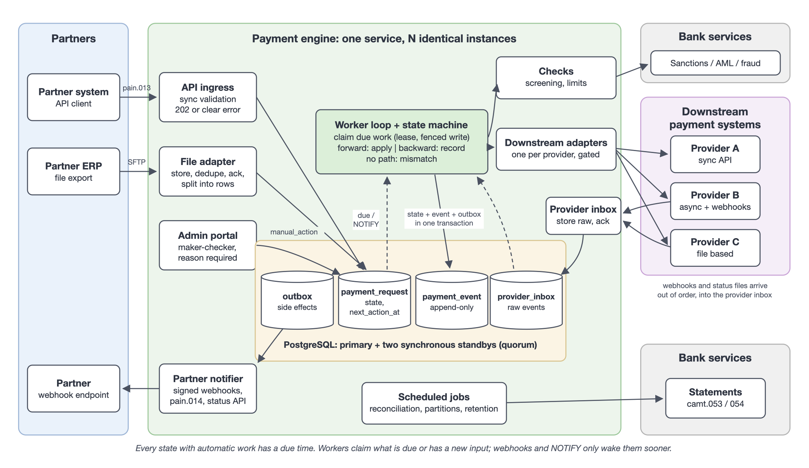

# Recommendation: partner payment processing engine

This is a recommendation for how to build the engine described in the brief. The core loop was built as a proof of concept to check it; [what that showed](#evidence-from-the-proof-of-concept) supports the recommendation, and [what it does not cover](poc-limits.md) is listed. Reference detail lives in the [companion documents](#data-security-and-operations). Every mechanism is labelled. **Built**: the proof of concept does it, with a test. **Designed**: part of the recommendation, not built. Designed work is either in the **first release** or added **later**, when its trigger arrives ([Delivery](#delivery-and-the-first-release)).

## The brief

A financial institution needs an engine that receives payment instructions from external partners (pain.013-style messages). Phase 1 is file and batch processing, with potentially thousands of requests per file. Phase 2, the strategic direction, is near-real-time API submission, one request at a time. The engine receives, validates, transforms to an internal representation, applies business rules, executes or routes, tracks the lifecycle of every instruction, and produces acknowledgements and status. Downstream payment systems can be synchronous, asynchronous, file-based or message-based.

| The brief asks for | Where it is answered |
|---|---|
| Phase 1: files with thousands of requests | [Front doors](#one-core-two-front-doors), [Files end to end](#files-end-to-end), [Volume budget](#risks-and-open-questions) |
| Phase 2: one request at a time through an API | [Front doors](#one-core-two-front-doors), [API sketch](#api-sketch) |
| Acknowledgement and processing status | [Status back to the partner](#status-back-to-the-partner) |
| Validates and applies business rules | [Validation, screening and routing](#validation-screening-and-routing) |
| Transforms into an internal representation | [Internal representation](#internal-representation) |
| Executes or routes, to downstreams of any style | [Downstream systems](#downstream-systems) |
| Tracks the lifecycle of every instruction | [Processing model](#processing-model), [States and partner statuses](#states-and-partner-statuses) |

The brief leaves payment types, schemes and downstream systems open on purpose, so this is a general engine. A scheme's own lifecycle and status codes are mapped onto the internal ones inside its adapter. Request to Pay is the worked example because pain.013 is one.

## Recommendation in brief

- **One core, two front doors.** Every submission becomes individual instructions processed by one pipeline. Files and the API are two ingestion adapters into the same core, so Phase 2 adds a door rather than a second engine.
- **One modular service, N identical instances, one PostgreSQL.** Every state with automatic work has a due time. A worker claims what is due or has a new input, under a lease with fenced writes. No queue broker, no per-state services.
- **An explicit, pure state machine.** Out-of-order downstream events are resolved by the state graph, never by clocks. Unknown outcomes are a state with an owner; a timeout never becomes a failure.
- **A downstream outage is not an unknown outcome.** The worker backs off and retries on its own. Only a payment that may need a resend, caught in an outage longer than a set horizon, goes to a person.
- **Everything the engine does is an event, and every other effect is an outbox row,** written in the same transaction as the state change. The downstream call itself is guarded by recording `SENDING` before it is made. Nothing is lost if a worker dies, and every status can be explained.
- **Downstreams hide behind adapters.** One adapter per downstream, one internal vocabulary, our own idempotency key on every call.
- **Build the failure paths first.** Duplicates, reordering, timeouts and takeovers decide whether this engine is trustworthy; the happy path is the easy part.

Simple topology; the complexity is the domain's, and it lives in one state machine and one table of due work.

## Questions first

The design changes less with the answers than the front doors do, but these decide scope.

1. **What drives the design?** Do partners want real time, or is the change internal? What happens today, and is any of it automated?
2. **Scope.** One-time payments only, or payment plans too? Bills only, or online checkout as well? Alongside existing e-invoicing and direct debit schemes, or an alternative to them?
3. **Files.** Do partners already export these files? Is there an existing host-to-host channel to reuse?
4. **Constraints.** Which currencies, downstream systems and SLAs are in scope?

pain.013 is a Creditor Payment Activation Request (Request to Pay). The status goes back as pain.014, and an accepted request is followed by a separate credit transfer, possibly several or a partial one. The final status waits on the debtor and on settlement, so status is asynchronous in both phases: Phase 2 removes batching, not asynchrony.

## Key decisions and alternatives

| Decision | Rejected | Why | Cost accepted |
|---|---|---|---|
| PostgreSQL is the work store: queue, scheduler and system of record | A broker beside the database; Kafka as the only store; a workflow engine | Payments are state, not messages: state, event and outbox are written in one transaction, and the status API, due times and reconciliation need queries. Kafka as the only store would avoid a dual write, but those needs still call for a queryable database, so it adds a dependency for little value. A workflow engine stays open: worth a spike if the bank already runs one | The primary's write throughput is the limit. The claim query needs a rewrite, and a payment takes about 20 transactions before the send today ([Risks](#risks-and-open-questions)) |
| A modular monolith, N identical instances | Services per stage or per state | One database means services would share a schema and get the costs of both. Roles are split out only when a measurement says so | One deployable; module boundaries kept by discipline |
| Inbox and outbox | Acting on events as they arrive; sending effects after commit | Events are stored before they are applied, and effects are stored with the state change, so a crash loses nothing and a rollback announces nothing | A dispatcher to run; delivery is at least once, so partners deduplicate |
| Unknown is a state with an owner | A timeout counts as a failure | A "failed" payment may have gone through: a retry pays twice, a reject misinforms the partner | A manual queue with a named owner |
| Outages: back off, with a horizon only for payments that may need a resend | A fixed number of retries; a circuit breaker alone | In the proof of concept, 11 of 11 payments in a 30-minute outage resolved without a person | The horizon, plus any frozen time, must stay inside each downstream's key retention, so key semantics must be known |
| Partition only `payment_event`, by the payment's creation month | Partition every table by creation month; partition by recorded time; no partitioning | A payment's history is never split, and the tables that need global uniqueness or hold parked events stay unpartitioned | Other tables are pruned by batched deletes until a measurement says otherwise ([database.md](database.md#partitioning)) |

## How a payment flows

A submission arrives through a front door, is stored, and is split into instructions. Each instruction is validated, screened, routed and sent through its downstream's adapter, then waits for the downstream, the debtor and settlement. Every step is one claim of one payment by one worker.

### One core, two front doors

Which front doors exist depends on question 1. If partners drive files, files are a permanent channel and the API is added beside it. If partners want an API, or nobody produces files yet, go straight to the API, with a bulk endpoint. A temporary file channel that partners are later moved off is rejected: partners see a forced migration as a downgrade, and anything given to partners is supported for years.

Granularity is not the difference: status, webhooks and cancellation are per instruction either way. The API adds feedback inside the partner's call, lower latency and keys scoped to submit or cancel. Files fit existing ERP exports, are efficient in bulk, and the file itself is an audit record. A file is a bulk API call with the same idempotency rules:

- Deduplicate per instruction (partner and end-to-end id). A corrected resend gets a new message id; already-accepted rows are no-ops. The same id with different content is a conflict, rejected explicitly, never a silent edit.
- End-to-end ids are unique per partner for good, as a published rule. The deduplication key outlives archiving, so an old id never becomes free again.
- A message id names one submission. The same message id with the same file hash is a duplicate and gets the original acknowledgement; with a different hash the whole message is rejected as a conflict.
- A file whose hash, or count plus control sum, matches a recent file from the same partner is held as a possible duplicate, because a re-exported file can carry fresh ids.

**Out of scope:** payment plans and mandates. They bring due-date rules, missed instalments and possibly consumer-credit regulation, which belong to the biller or a separate product. The engine keeps an optional parent reference on each instruction and emits status events rich enough to reconcile a plan against. Under- and overpayment of a single request is in scope ([Settlement](#settlement-and-reconciliation)). Also out of scope, on purpose: handling contests (a debtor's dispute, a bank's recall for fraud or duplication, a chargeback where the rail allows one). Investigation, evidence, the decision and returning the funds belong to a separate disputes and returns flow. The engine only records them, under the rule in [States and partner statuses](#states-and-partner-statuses).

### Files end to end

One batch concept serves four uses. A batch has a state, a cut-off and a whole-file failure of its own; the instructions inside it are processed one by one by the same core. Partner files are in the first release when question 1 chooses files; the downstream batches come with the first non-synchronous downstream. A partner file is stored, then split into rows in bounded chunks, so one huge file never holds a long transaction. Under all-or-nothing, rows are made due only once every row has passed synchronous validation, in one update; any failure rejects the file and no row is ever due. The hold covers synchronous validation only: a later screening hit affects its own instruction, never the file. The proof of concept ingests a submission in one transaction.

| Batch | States | Cut-off | Whole-file failure |
|---|---|---|---|
| Partner file in (pain.013) | `RECEIVED`, `HELD` (possible duplicate), then `SPLIT` or `REJECTED` | The business calendar sets the earliest execution date | A schema or control-total failure, a message-id conflict, or, under all-or-nothing, any synchronous rejection: `REJECTED`, with a file-level acknowledgement |
| Status file out (pain.014) | Open, closed, delivered | The partner's reporting schedule | Delivery is retried from the outbox; the file can be rebuilt from its statuses |
| Downstream file out | Open, closed at cut-off, sent, acknowledged or rejected | The downstream's cut-off | A whole-file reject raises an alert; its payments wait in `SENDING` until a person approves a resend under the same keys |
| Return file in | Received, applied (one provider event per line) | The downstream's report schedule | Missing or unreadable by its deadline raises an alert; silence before it is expected |

### API sketch

Designed, added when the API ships unless question 1 puts it in the first release.

- `POST /submissions` (one or bulk): `202` with the instruction ids, a non-retryable error, or `429` with `Retry-After` under backpressure.
- `GET /instructions/{id}`: current status, event sequence and under-review flag.
- `GET /changes?since={cursor}`: every status since the partner's cursor.
- `POST /instructions/{id}/cancel`, and cancel everything not yet final in a submission.
- `PUT /webhook`: register the URL statuses are pushed to.
- Latency from submit to send: a target agreed with partners, met by `NOTIFY` wake-ups and an interactive claim lane.

### Internal representation

Parse and validate at the edge, then work on one canonical instruction: partner and message references, end-to-end id, amount as integer minor units plus ISO 4217 currency and its exponent, the amount-modification terms and charge bearer, debtor and creditor identification, remittance reference, requested execution date, expiry, optional parent reference, and a content hash for conflict detection. Channel and downstream formats never reach the core: one mapping in per channel, one out per downstream. The received file stays in write-once object storage with its hash recorded at receipt. Message versions are explicit, and an unsupported one gets a non-retryable error. XML is parsed with hardening ([threat-model.md](threat-model.md)).

### Validation, screening and routing

- **Synchronous at ingestion:** schema, field limits, required fields, duplicate ids, known partner, usage profile, amounts parsed exactly, and a currency that some downstream offers to this partner.
- **Asynchronous before routing:** sanctions, AML, fraud and partner limits, as lifecycle states. Sanctions screening always fails closed. A dependency outage parks the instruction in `PENDING_SCREENING`; a potential match waits in `SCREENING_REVIEW` for a two-person decision. A compliance rejection carries one generic reason code, so it never discloses a suspicion. Per-partner value limits are reserved atomically.
- **Routing** chooses the downstream from currency, partner and capability, and stores it when the payment enters `READY_TO_SEND`. Routing checks the currency against that downstream again; a payment no route can take is `REJECTED` with a reason. No FX inside the engine.
- **Rules are data.** Partner profiles and routing rules live in configuration, with a reason recorded for every rejection. Partner trend signals feed the bank's transaction monitoring.

### Processing model

- **Every state with automatic work has a due time** (`next_action_at`). There is one kind of work: claim a payment that is due or has an unapplied input, apply the input or do the step its state calls for, and write the new state with its new due time, its events and its outbox rows in one transaction. Retries, backoff, response windows, expiry and deadlines are all due times. No due time means a person, or nothing unless an input arrives ([table](#states-and-partner-statuses)). Built.
- **Inputs** are the worker's own next step, a provider event, a partner cancellation, an approved manual action, a matched statement credit, a response timeout, expiry and a business deadline. The next step, a response timeout, expiry and a business deadline are due times. The others are rows written by whoever received them, and only the lease holder applies them, so the claim looks for every kind of unapplied input as well as due rows ([database.md](database.md#claiming)). Provider events, cancellations and timers are built; the rest are designed for the first release.
- **Claim, lease and fence.** A short `SKIP LOCKED` transaction sets a lease and increments a lease token; the work happens outside it; the result is a compare-and-set on the lease token and event sequence. No row lock is held across a downstream call. Built; the timeouts and database clock that make expiry mean "the worker stopped" are designed for the first release ([database.md](database.md#claiming)).
- **Gates control sends.** One gate row per downstream, per partner and one global holds pause, maintenance window, circuit state, send rate and an in-progress limit. A gate blocks only the send step, never status queries, inputs or timers ([operations.md](operations.md#gates)). Pauses and the kill switch are designed for the first release; the rest come later.
- Webhooks and `LISTEN/NOTIFY` only wake workers sooner; the table plus polling is the guarantee. Wake-ups are sent from a separate session, never inside a state-change transaction, so commits do not wait on each other under synchronous replication. Designed, first release; the proof of concept polls.

### Downstream systems

One adapter per downstream (an anti-corruption layer), one internal state machine, one internal error vocabulary (ISO external status reason codes). The aim is for the four styles in the brief to differ only inside the adapter, converging on a send with our idempotency key and events into the provider inbox. Only the synchronous style was built.

| Downstream style | Sending | Status and results | Watch for |
|---|---|---|---|
| Synchronous API | The response is the answer | Status query by our key | A timeout after the downstream processed it: ask, never resend blindly |
| Asynchronous with webhooks | The response only acknowledges receipt | Webhooks into the inbox, status query as backstop | Duplicates, reordering, events before we hold the reference |
| File-based | Collected into a [downstream file](#files-end-to-end) per cut-off | Return files, one provider event per line | Whole-file rejects, partial acceptance, a file arriving late |
| Message-based | Publish with our key as correlation id | Replies on a queue, each a provider event | A publish acknowledgement is not acceptance; replies out of order; poison messages |

- **The idempotency key** is derived from the partner, the end-to-end id and the attempt, hashed into the downstream's format, so it survives a database restore ([database.md](database.md#payment_request-1) says when the attempt increments). The proof of concept uses `paymentId:attempt` ([poc-limits.md](poc-limits.md)).
- **Pin down the key's semantics** with the downstream's owners and test them before building its adapter: how long a key is kept (it bounds the outage horizon), what a repeated key returns (it must be the original result, never a reject), whether status can be queried by our key, and its format (ISO 20022 identifiers are at most 35 characters). These go in a capability matrix with the downstream's style, cut-offs, maintenance windows, rate limits and currencies.
- **Bound at routing, drained before retirement.** A payment is never re-routed after `SENDING`, so a routing rollback applies to new payments only. A retired downstream stops new sends and keeps answering status queries, returns and recalls until its return window closes.

### Status back to the partner

The partner needs three things: **receipt** (inside the API call, or a file-level acknowledgement with accepted and rejected counts against the control totals), **per-instruction status** for each partner-visible change, and the **final outcome**, which for a Request to Pay waits on the debtor and on settlement. Statuses go out through the outbox as webhooks, a status API and pain.014 files, at least once with a stable event id, until a maximum delivery age, then through the "changes since" feed. Every status carries the payment's event sequence so partners can order them. A daily report gives counts and values per status. File partners can cancel per instruction or per submission (camt.055 style, answered with camt.029). Webhook signing and the webhook URL rules are in [threat-model.md](threat-model.md). The outbox is built; the dispatcher is designed for the first release ([database.md](database.md#outbox-1)).

## States and partner statuses

The state machine is an explicit transition table, pure and side-effect free: it takes a context (state, last known downstream position, whether a cancellation was asked for and by whom) and an input, and returns the new context, one step per state passed through, and the effects of each step. Built, apart from who asked. Out-of-order provider events are resolved by the graph, not the clock. Target ahead and reachable: applied, skipped states recorded as inferred. Behind, or after a final state: recorded as stale, not applied, except late money after a not-paid outcome ([Settlement](#settlement-and-reconciliation)). No path: `MISMATCH`, with an alert. A provider event never skips validation, screening or the send. Built.

This table is the one definition of the states and statuses; the other documents link here. The status vocabulary is a contract and published values are forever. "Accepted" is documented as accepted for processing, not as paid.

| State | The partner sees | Due time | Waits on | Final |
|---|---|---|---|---|
| `RECEIVED`, `VALIDATED`, `PENDING_SCREENING` | Receipt only | Now (screening retried while it is down) | The worker | No |
| `SCREENING_REVIEW` | Nothing beyond the last status, no flag | None; compliance sets an internal time limit | A person (two-person decision) | No |
| `READY_TO_SEND` | Nothing new | Now; later while a gate blocks the send | The worker | No |
| `SENDING` | Nothing new | Response window, or expiry if sooner; backoff in an outage | The downstream | No |
| `PRESENTED` | `PRESENTED` | Response window, or expiry if sooner | The downstream and the debtor | No |
| `ACCEPTED` | `ACCEPTED` | Not-paid deadline | The debtor's payment | No |
| `CANCELLATION_REQUESTED` | `CANCELLATION_REQUESTED` when the partner asked; nothing new for an expiry | Response window | The downstream | No |
| `PAID`, `PAID_LATE` | The same | Settlement deadline | Reconciliation | No; for a partner onboarded without statement access, `PAID` and `PAID_LATE` are final, with no settlement deadline |
| `SETTLED`, `REJECTED` | The same | None | Nothing | Yes |
| `REFUSED`, `EXPIRED`, `CANCELLED`, `NOT_PAID` | The same | None | Nothing | Final unless money arrives, then `PAID_LATE` |
| `UNKNOWN` | The last status, with an under-review flag and its start date | Expiry, if it has not passed; otherwise none | A person | No |
| `MISMATCH`, `QUARANTINED` | The last status, with an under-review flag and its start date | None | A person | No |

Two partner statuses belong to linked records, not to payment states: `RETURNED`, for money returned after `SETTLED`, and a refusal for a cancellation that came too late. Both are fixed in Step 0. **A payment never moves backwards.** A contest, a return or an overpayment after `SETTLED` is a linked record with its own lifecycle and partner-visible status; `SETTLED` stays `SETTLED`. A contest reported before `SETTLED` follows the existing rule: money back after `PAID` is a `MISMATCH`. A payment with an open linked record is not dropped at the end of the legal period until the record closes. The proof of concept has every state above except `SCREENING_REVIEW`, `QUARANTINED`, `NOT_PAID` and `PAID_LATE`, and its `ACCEPTED` times out to `UNKNOWN` ([poc-limits.md](poc-limits.md)).

## Settlement and reconciliation

**Paid and settled are separate.** `PAID` means the downstream reports the payment made; payout platforms report paid once money reaches the payee's bank, and it can still come back. `SETTLED` means reconciliation against the partner's account statements (camt.053/054) confirmed the money arrived, for the full amount. A partner that acts on `PAID` takes that risk knowingly. Built (the proof of concept accepts `SETTLED` as a downstream event); everything else here is designed for the first release.

- **Reading the partner's statements is a condition of onboarding.** A partner onboarded without it, by exception, has `PAID` and `PAID_LATE` as final statuses in its contract: no settlement deadline, and both count as final for retention.
- **Reconciliation only proposes.** It matches statement credits and writes them as unapplied statement matches; the worker applies each one through the state machine. Matching order: the end-to-end id; then the creditor reference plus amount plus debtor; then a person. Each credit matches one request only; credits that match none are reported to the partner and queued with an owner.
- **A running total.** Each matched credit is an event with its amount. `SETTLED` is reached when the total meets the request's amount rule: the exact amount, or within its amount-modification terms, with a per-route tolerance for charges intermediaries deduct. A credit that takes the total over the rule before `SETTLED` is a `MISMATCH`. After `SETTLED` it is a linked overpayment record with an owner, like a return, and `SETTLED` does not change.
- **Deadlines are business days.** The not-paid deadline is the requested execution date plus a set number of business days. At it, the worker asks the downstream first, under the outage rules: a later state is applied; with no credit and no later state the payment moves to `NOT_PAID`; with a partial credit, to `MISMATCH`. The settlement deadline is the `PAID` time plus a per-route number of business days; a total still short of the rule then moves the payment to `MISMATCH`, with an owner.
- **Late money corrects a not-paid outcome.** A `PAID` provider event or a matched credit after `REFUSED`, `EXPIRED`, `CANCELLED` or `NOT_PAID` moves the payment to `PAID_LATE`, and settlement follows as usual. Any other outcome after a final state is recorded as stale with an alert. A reject, refusal or cancellation after `PAID` is a `MISMATCH`. A matched credit can move `ACCEPTED` straight to `SETTLED`.

## Cancellation and expiry

Cancellation is per instruction, asked by the partner (API or file) or by expiry, through one input. Expiry is a due time and is checked before every send.

- **Not yet sent:** cancelled at once (`CANCELLED`, or `EXPIRED` for an expiry) and never sent.
- **In flight** (`SENDING`, `PRESENTED`, or `UNKNOWN` because it may still be in flight): the payment moves to `CANCELLATION_REQUESTED` and the worker forwards the cancellation, recording who asked. A confirmation moves it to `CANCELLED`, or `EXPIRED` for an expiry. Silence follows the waiting rules (ask, back off, `UNKNOWN`), never a final status.
- **The race with the debtor:** a `PRESENTED` acknowledgement after the request does not undo it; if the debtor accepts first, the payment follows to `ACCEPTED` and the cancellation lost. Only a cancellation we asked for can be confirmed, and not once the debtor accepted; otherwise it is a `MISMATCH`.
- **Too late** (accepted, paid, already requested): answered with the refusal status, not dropped.
- A gate never blocks a cancellation. Undoing an executed payment is a separate refund or return flow.

Built for partner cancellations, except the refusal status (the proof of concept records a too-late cancellation as stale). Expiry, file cancellation and the refusal are designed for the first release. A cancelled payment the downstream never received ends in `UNKNOWN`: an accepted gap, resolved by a manual action.

## When things go wrong

- **A worker stops mid-send.** `SENDING` is recorded with its attempt before the downstream call, and an overdue `SENDING` is checked against the downstream before anything else, cancellations included. Known: store the reference. Unknown and no reference held: resend under the same key. Unknown although it gave us a reference: `UNKNOWN`, never a resend. Built ([recovery.md](recovery.md#with-a-status-endpoint)).
- **A downstream is down.** An unanswered call or an adapter failure is an outage, not an unknown outcome: the payment keeps its state and backs off. The horizon applies only to payments that may need a resend; an acknowledged payment backs off at the cap while a person is alerted about the downstream. Pauses and maintenance windows freeze the horizon, but never past the downstream's key retention. Backoff and horizon built; the narrower horizon and the pause freeze designed for the first release, maintenance windows later ([recovery.md](recovery.md#downstream-outages)).
- **A payment fails on every claim.** A failure count, written in the claim transaction, backs it off and then moves it to `QUARANTINED` for a person. Designed, first release ([database.md](database.md#claiming)).
- **Nobody can tell what happened.** The worker asks the downstream before giving up, so `UNKNOWN` means no source could place the payment. It has an owner and never expires into a failure; a late event still resolves it. Built ([recovery.md](recovery.md#what-needs-a-person)).
- **The database fails or must be restored.** Two synchronous standbys with quorum commit lose no acknowledged write when a node or zone is lost ([database.md](database.md#availability)). A restore to an earlier point follows a runbook that stops sends and asks the downstream before resending ([recovery.md](recovery.md#restore-to-an-earlier-point)). Designed, first release.

## Money and time

- Amounts are integer minor units with the currency's ISO 4217 exponent stored beside them, so a change in a currency table never rescales a stored amount. Currency travels end to end; direction is explicit, not a sign. Amounts are parsed as strings, never floats. Built, except the stored exponent.
- The requested amount is exact in its currency or rejected. Calculated amounts are rounded once, by a published rule, recorded as an event. Downstreams never round.
- A file's control sum is an exact decimal, because ISO sums amounts across currencies.
- Timezone-aware storage, an injected clock, and an explicit business calendar and zone for cut-offs, expiry and deadlines.

## Data, security and operations

[database.md](database.md) holds the schema, the claim, [availability](database.md#availability), [partitioning](database.md#partitioning), [retention and erasure](database.md#retention-and-erasure) and [integrity](database.md#integrity). [threat-model.md](threat-model.md) holds the threats per trust boundary, including webhook SSRF and signing, XML hardening and the hash chain. [operations.md](operations.md) holds gates, manual actions and maker-checker, queue owners, alerts, the deploy rule, scheduled singletons and the platform. [recovery.md](recovery.md) holds how each failure recovers and everything that needs a person.

## Evidence from the proof of concept

The core loop was built and exercised against a real PostgreSQL: the state machine, ingestion with deduplication, the worker with lease and fenced writes, the provider inbox, and one fake downstream that can delay, duplicate, reorder, reject, time out and go down. It shows the recommended design holds under the failures that matter, and it changed the recommendation in these places:

- **Duplicate submission, out-of-order events, timeout to `UNKNOWN`, takeover mid-send and amount invariants** all behave as specified, including with several workers racing. Each safeguard was checked by breaking it on purpose.
- **The state machine needs a context.** A bare state forgot how far a payment got after a timeout or a cancellation; the downstream position and the cancellation flag fixed that.
- **Takeover and timeouts must ask first.** Resending after the downstream accepted a payment would create a second one, so a stored reference sends it to `UNKNOWN`; and a timeout that does not ask leaves a paid payment with a lost webhook in `UNKNOWN`.
- **Races need explicit locks and order.** An event arriving as its reference is stored could be left parked forever until a per-reference lock was added; concurrent resends deadlocked until rows were inserted in a fixed order.
- **Every effect belongs in the outbox,** not only partner statuses, so that a worker dying after commit cannot lose a cancellation forward, a reconciliation request or an alert.
- **An outage must not become manual work.** With a fixed number of retries, every payment in a 30-minute downstream outage ended in `UNKNOWN`. Backoff up to a horizon resolved all of them without a person.
- **Paid is not settled.** Splitting them keeps the state graph honest: money that comes back after `PAID` is a mismatch, not a quiet change.

Independent code reviews of the proof of concept found each of these before it could matter. What it does not cover, and its known gaps, are in [poc-limits.md](poc-limits.md).

## Risks and open questions

- **Throughput under quorum commit is unmeasured.** A rough volume budget, as an estimate: a 50,000-instruction file at about 20 transactions per payment before the send is about a million commits, each waiting for a standby. The claim query as built takes about 250 to 300 ms at 50,000 rows, which alone would be hours per worker; the rewrite measured about 0.5 ms. After the rewrite, commit latency sets the drain time. The first lever is to combine consecutive in-process steps (validation, screening, routing) into one claim. Measure with a load test against a synchronous standby before go-live.
- **Response windows.** One window cannot serve both silent-downstream detection in `SENDING` and a debtor's decision time in `PRESENTED`. Set them per state from the downstream's real behaviour.
- **Downstream key semantics** decide whether a resend is safe. Get them from the first downstream's owners and test them before building its adapter.
- **Source timestamps and raw provider messages** are needed for audit and must be kept from day one.
- **Reconciliation and manual resolution** of `UNKNOWN` and `MISMATCH` are where operations will live day to day; design them with operations early. [recovery.md](recovery.md) lists every cause.
- **Downstreams without a status endpoint** recover through key-based resends, event replay, reports and statements, and more of their failures need a person ([recovery.md](recovery.md#without-a-status-endpoint)).
- **Front doors, validation rules and screening** are scoped by the questions at the top, and need partners and the bank's risk functions.

## Delivery and the first release

Step 0 blocks everything else: canonical model, transition table, event schema, status vocabulary, and the API and file contracts. Then parallel streams (ingestion, core lifecycle, first downstream with simulator, partner status and docs, controls, platform, risk, reconciliation) share one definition of done: failure scenarios tested, audit events emitted, alerts with a runbook, docs, security review, deployed through the pipeline. Tests cover illegal transitions, duplicates, out-of-order events, timeouts, partial failure, resubmitted files and amount invariants, against a real Postgres and misbehaving downstream simulators, with contract tests against downstream test environments; the sequence explorer and mutation checks from the proof of concept stay. Rollout: one pilot partner and one vetted downstream, a parallel run against the existing process compared per instruction with an exit criterion stated up front, per-partner routing as rollback, then batches.

**The first release** is the pilot: one partner, one downstream with a status endpoint, one front door. It holds what cannot be retrofitted and what protects money:

- **Step 0 contracts:** the full status vocabulary from the [table](#states-and-partner-statuses), with `RETURNED` and the cancellation refusal; the pain.014 mapping; the event schema with source timestamps, raw messages and the transition-table version; the downstream key and its attempt rule; the deduplication key table and the end-to-end id rule; amounts stored with their exponent.
- **Core loop** (built), plus jitter, the claim rewrite with every input, a connection pool, timeouts shorter than the lease, and the database clock.
- **The front door question 1 chooses,** with staged, chunked file ingestion, control totals, partial and all-or-nothing acceptance, the duplicate hold, XML hardening and field limits if it is files.
- **Partner status delivery** from the outbox, signed if by webhook; **one downstream adapter** with verified key semantics; **screening** that fails closed.
- **Reconciliation to `SETTLED`** with the running total, the matching order and both deadlines.
- **Manual actions** with maker-checker, including bulk actions by cause; **quarantine**; **gates** with pauses and the global kill switch; the outage horizon only for payments that may need a resend, frozen by pauses.
- **Integrity** grants, the unique event sequence, the deferred trigger and the daily consistency job; **availability** with two standbys and the restore runbook; **partitioning** of `payment_event` only; the expand-then-contract deploy rule; alerts and manual queues with owners; a load test.

**Added when its trigger arrives:**

| Trigger | Added |
|---|---|
| The API ships | The API, interactive claim lane, `429` backpressure, key scopes, the "changes since" feed |
| A second partner | Partner fairness in the claim, per-partner in-progress limits, per-partner outbox lanes with a circuit breaker and maximum delivery age |
| A second or fragile downstream | The gate's circuit breaker, send rate and warm-up, the maintenance-window freeze, routing rules, retirement |
| A non-synchronous downstream | Downstream and return files, file or message adapters, report ingestion, recovery without a status endpoint |
| The first month nears its legal period | Retention drops, and escalating payments still open |
| Later | The hash chain and its daily anchor; asking once more about payments an outage sent to `UNKNOWN`; reports resolving `UNKNOWN`; the debtor-and-amount duplicate rule; partitioning more tables, if measured |
