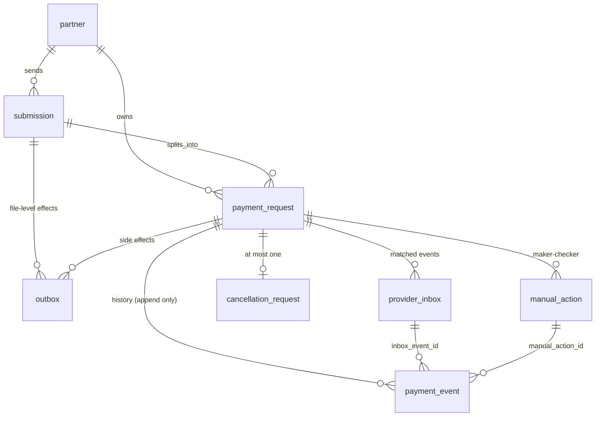

# Database

The recommended data model: PostgreSQL, a single primary with two synchronous standbys (quorum `ANY 1`, see [Availability](#availability)). The proof of concept's schema is two Flyway migrations: [V1__initial_schema.sql](../src/main/resources/db/migration/V1__initial_schema.sql) (the tables) and [V2__downstream_position_and_cancellation.sql](../src/main/resources/db/migration/V2__downstream_position_and_cancellation.sql) (two columns the state machine needs). The migrations are the source of truth for the structure; this page explains it and the rules it enforces, then the [changes the recommendation makes](#changes-the-recommendation-makes). Change the schema through new migrations only. The design behind it is in [architecture.md](architecture.md).

## Structure at a glance



Every state change touches several tables in one transaction (see [Transactions](#transactions)):

```
input table ──► worker (lease) ──► payment_request  (state, due time, lease, event_seq)
provider_inbox                  ├─► payment_event    (one row per step)
cancellation_request            ├─► outbox           (one row per effect)
manual_action                   └─► input marked applied
statement_match (designed)
outbox FORWARD_CANCELLATION
```

## Tables

| Table | Purpose | Mutable? |
|---|---|---|
| `partner` | Partner configuration: acceptance mode, in-progress limit (`max_in_flight`), runtime pause | Yes |
| `submission` | One row per file or API call, as received | Status only |
| `payment_request` | Current state of each instruction, its due time and lease | Yes |
| `payment_event` | Lifecycle history and business audit trail | Insert only |
| `provider_inbox` | Raw downstream events as received | Status and payment link only |
| `outbox` | Every side effect of a state change: partner deliveries and internal effects | Delivery fields only |
| `manual_action` | Maker-checker requests for state-changing manual actions | Status, decision and applied fields only |
| `cancellation_request` | Partner cancellation requests, applied by the worker | Applied field only |

"Mutable?" is enforced by grants to the application role, which are set per environment and are not in the migration. Retention and erasure (below) run under a separate maintenance role.

## Columns

`pk` primary key, `fk` foreign key, `uq` part of a unique constraint. Types are the Postgres types in the migration.

### partner

| Column | Type | Notes |
|---|---|---|
| `id` | uuid | pk |
| `external_ref` | text | uq. The partner's reference, used by the front doors |
| `name` | text | |
| `acceptance_mode` | text | `PARTIAL` (default) or `ALL_OR_NOTHING` |
| `max_in_flight` | integer | > 0, default 100 |
| `paused` | boolean | Runtime pause, default false |
| `created_at` | timestamptz | |

The proof of concept stores these but its core loop does not read `acceptance_mode`, `max_in_flight` or `paused`. The recommendation moves the pause and the in-progress limit to the partner's [gate](operations.md#gates).

### submission

| Column | Type | Notes |
|---|---|---|
| `id` | uuid | pk |
| `partner_id` | uuid | fk `partner`; uq with `message_id` |
| `channel` | text | `API` or `FILE` |
| `message_id` | text | The partner's message id. The recommendation: the same id with the same file hash is a duplicate, with a different hash a conflict. The PoC instead adds new instructions under a reused id to the existing submission |
| `received_at` | timestamptz | |
| `file_object_key` | text | Object storage key of the received file (personal data, see below) |
| `declared_count`, `declared_sum_minor` | integer, bigint | Control totals declared by a file. The recommendation stores the sum as an exact decimal, since ISO sums amounts across currencies |
| `status` | text | `RECEIVED`, `SPLIT` or `REJECTED` |

### payment_request

| Column | Type | Notes |
|---|---|---|
| `id` | uuid | pk |
| `partner_id` | uuid | fk; uq with `end_to_end_id` |
| `submission_id` | uuid | fk `submission`, indexed |
| `end_to_end_id` | text | The partner's id for the instruction |
| `content_hash` | text | Hash of the parsed content, to tell a resend from a conflict |
| `parent_ref` | text | Optional payment-plan reference, not interpreted |
| `state` | text | Not constrained in the schema (see [State values](#state-values)) |
| `amount_minor` | bigint | > 0, minor units |
| `currency` | char(3) | `[A-Z]{3}` |
| `amount_modification_allowed` | boolean | default false |
| `expires_at` | timestamptz | Internal expiry; not exercised by the proof of concept |
| `debtor_identification`, `creditor_identification`, `remittance_reference` | text | Personal data |
| `downstream` | text | Which downstream the payment was sent to. The recommendation stores it at routing, when the payment enters `READY_TO_SEND` |
| `downstream_ref` | text | The downstream's reference for it; unique per `downstream` |
| `send_attempt` | integer | default 0; part of the downstream idempotency key (see [Downstream](#payment_request-1)) |
| `next_action_at` | timestamptz | Due time; null = no automatic work |
| `lease_owner`, `lease_until` | text, timestamptz | The current claim |
| `lease_token` | bigint | Incremented on every claim; the fence |
| `event_seq` | integer | Last `payment_event.seq` written; the second half of the fence |
| `downstream_position` | text | V2. `SENDING`, `PRESENTED` or `ACCEPTED`; null until `SENDING` was recorded |
| `cancel_requested` | boolean | V2. A partner cancellation was applied. Default false. The recommendation also records who asked: the partner or expiry |
| `created_at`, `updated_at` | timestamptz | |

### payment_event (partitioned by `recorded_at` in V1)

| Column | Type | Notes |
|---|---|---|
| `payment_id`, `seq`, `recorded_at` | uuid, integer, timestamptz | pk; `payment_id` is a fk |
| `type` | text | What happened; see [event types](#event-types) |
| `from_state`, `to_state` | text | Equal for steps that do not change state |
| `outcome` | text | `APPLIED`, `INFERRED`, `STALE`, `NO_PATH` |
| `category` | text | `BUSINESS` or `TECHNICAL` |
| `actor_type`, `actor_id` | text | `PARTNER`, `SERVICE`, `DOWNSTREAM` or `ADMIN` |
| `reason`, `manual_action_id` | text, uuid | Both required for `ADMIN`; `manual_action_id` is a fk |
| `correlation_id` | text | One file or API call across its payments |
| `inbox_event_id` | bigint | fk `provider_inbox` |
| `payload` | jsonb | Mapped reason codes, downstream references; never personal data |
| `occurred_at`, `recorded_at` | timestamptz | |

### provider_inbox

| Column | Type | Notes |
|---|---|---|
| `id` | bigserial | pk |
| `provider`, `provider_event_id` | text | uq. `provider` uses the same values as `payment_request.downstream` |
| `provider_timestamp` | timestamptz | A hint, never the deciding vote |
| `received_at` | timestamptz | |
| `downstream_ref` | text | Extracted on arrival, used for matching |
| `payment_id` | uuid | fk; null while parked |
| `status` | text | `NEW`, `APPLIED`, `PARKED` |
| `payload` | jsonb | The event |

### outbox

| Column | Type | Notes |
|---|---|---|
| `id` | bigserial | pk |
| `payment_id`, `event_seq` | uuid, integer | A payment effect, keyed on the event that caused it |
| `submission_id` | uuid | fk; a file-level effect. Exactly one of `payment_id` and `submission_id` is set |
| `kind` | text | See [outbox](#outbox-1) |
| `payload` | jsonb | |
| `next_attempt_at`, `attempts`, `delivered_at` | timestamptz, integer, timestamptz | Delivery bookkeeping |

### manual_action

| Column | Type | Notes |
|---|---|---|
| `id` | uuid | pk |
| `payment_id`, `submission_id` | uuid | fk, indexed; exactly one is set, as in `outbox` (`submission_id` for held-file decisions, designed) |
| `action`, `reason` | text | |
| `requested_by`, `requested_at` | text, timestamptz | |
| `approved_by`, `approved_at` | text, timestamptz | Null while `PENDING` |
| `status` | text | `PENDING`, `APPROVED`, `REJECTED` |
| `applied_at` | timestamptz | Only for an approved action |

### cancellation_request

| Column | Type | Notes |
|---|---|---|
| `id` | uuid | pk |
| `payment_id` | uuid | fk; unique, so one request per payment |
| `requested_by`, `requested_at` | text, timestamptz | |
| `applied_at` | timestamptz | Set by the worker in the transaction that applies it |

## Indexes

| Index | On | Serves |
|---|---|---|
| `payment_request_due_idx` | `next_action_at` where not null | The timer path of the claim query |
| `payment_request_downstream_ref_idx` | unique `(downstream, downstream_ref)` where `downstream_ref` is not null | One payment per downstream reference; matching events |
| `payment_request_submission_idx` | `submission_id` | Payments of a submission |
| `provider_inbox_payment_idx` | `payment_id` where `status = 'NEW'` | Unapplied events of a payment |
| `provider_inbox_parked_idx` | `(provider, downstream_ref)` where `status = 'PARKED'` | Relinking parked events |
| `cancellation_request_unapplied_idx` | `payment_id` where `applied_at` is null | Unapplied cancellations |
| `manual_action_payment_idx`, `manual_action_unapplied_idx` | `payment_id` (the second where approved and not applied) | Actions of a payment |
| `outbox_due_idx` | `next_attempt_at` where `delivered_at` is null | Delivery |

## payment_request

The unit of processing. One row per instruction.

- **Identity.** `unique (partner_id, end_to_end_id)` is the idempotency key across channels and resends. Partners must use a new end-to-end id for every instruction (a published rule), and the key must outlive archiving. The recommendation keeps `(partner_id, end_to_end_id, content_hash)` in an unpartitioned deduplication key table, and drops the hash after the legal period, so an old id never becomes free again. `content_hash` detects a resend that reuses the id with different content: that is a conflict, never an update. It is computed over the parsed amount (so `12.5` and `12.50` are the same), with length-prefixed fields so no two different instructions can collide.
- **Money.** `amount_minor` is an integer in the currency's minor units; `currency` is the ISO 4217 code. No floats anywhere. The recommendation stores the currency's exponent with each amount.
- **Work scheduling.** `next_action_at` is the due time; null means no automatic work is due. Which states have one, and what it is, is in the [states table](architecture.md#states-and-partner-statuses). Alerts on waiting states key on `state`, not on the due time. While a downstream is unreachable the due time backs off ([recovery.md](recovery.md#downstream-outages)).
- **Only the lease holder writes state.** External inputs never update this table directly: provider events go to `provider_inbox`, cancellations to `cancellation_request`, approved manual actions stay in `manual_action`, and, in the recommendation, reconciliation writes only `statement_match` rows. The worker picks them up under a lease and applies them through the state machine ([Claiming](#claiming)). This is what makes the fence complete.
- **Lease and fencing.** `lease_owner` and `lease_until` record the current claim. `lease_token` increments on every claim. The result is a compare-and-set: `WHERE id = ? AND lease_token = ? AND event_seq = ?`. A slow worker cannot overwrite a takeover, and nothing else can have written in between. Every successful write renews the lease. Releasing it (null owner and expiry) is fenced on the token alone.
- **Event sequence.** `event_seq` is the last sequence number written to `payment_event` for this payment. The fenced update increments it by the number of events being written (more than one when a transition records inferred states) and returns the new value; every `payment_event` insert takes its `seq` from that value in the same transaction. That keeps the sequence gap-free and ordered, which the partitioned event table cannot enforce on its own. The one allowed jump is a `RESTORED` event written by the [restore runbook](recovery.md#restore-to-an-earlier-point).
- **Downstream.** `downstream` and `send_attempt` are stored before the downstream call, so a takeover mid-send knows which attempt was in flight. `downstream_ref` is stored only once the downstream has answered (the send response or a status query), so it can be null for a payment that was sent; events for such a payment stay parked until the reference is learned. A reference that is not usable (empty, too long, control characters, or already held by another payment) is never stored: the payment goes to `UNKNOWN`.
- **The downstream idempotency key** is derived from the partner, the end-to-end id and the attempt, hashed into the downstream's format, never from the worker or a random id, so it survives a database restore. The proof of concept uses `paymentId:attempt` ([poc-limits.md](poc-limits.md)). The attempt is 1 for the first send and keeps its number for every resend, automatic or manual: a downstream that has nothing under the key takes it as new. It increments only through an approved manual resend after the downstream confirmed that the earlier attempt ended without payment, and the new attempt is written with `SENDING`. So attempts run 1, 2, 3 without gaps, each known to the downstream before the next exists, which is what the [restore runbook](recovery.md#restore-to-an-earlier-point) relies on.
- **Downstream position and cancellation** (V2). `downstream_position` is the last known downstream state (`SENDING`, `PRESENTED` or `ACCEPTED`; a `PAID` payment keeps `ACCEPTED` here; the state machine treats `PAID` itself as the position, since it can no longer time out), null until `SENDING` was recorded, which happens before the downstream call. It survives `UNKNOWN` and `CANCELLATION_REQUESTED`, which would otherwise forget how far the payment got: a late event is stale or applied relative to it, never relative to a guess. `cancel_requested` is set when a cancellation was applied; only then can a downstream cancellation confirmation be accepted, and not once the position is `ACCEPTED`. The recommendation records who asked, so a confirmation leads to `CANCELLED` for the partner and `EXPIRED` for expiry. The state machine reads and returns these with the state. The `CHECK` on `downstream_position` is the one place the schema constrains state names; renaming an in-flight state needs a migration.
- **Plans.** `parent_ref` is an optional reference for whoever owns a payment plan. The engine does not interpret it.

### State values

The `state` column is not constrained in the schema while the state list is a draft. The recommended values, which of them have a due time, which wait on a person and which are final, are in the [states table in architecture.md](architecture.md#states-and-partner-statuses). The proof of concept's `State.kt` has all of them except `SCREENING_REVIEW`, `QUARANTINED`, `NOT_PAID` and `PAID_LATE`.

## payment_event

Append-only. The application role has `INSERT` and `SELECT` only; no `UPDATE` or `DELETE` (granted outside the migration, per environment).

- One row per lifecycle event: `type`, `from_state`, `to_state`. A transition that infers skipped states writes one row per step.
- `outcome`: `APPLIED`, `INFERRED` (a skipped state on a valid path), `STALE` (recorded, not applied) or `NO_PATH` (contradicts the current state; the payment moves to `MISMATCH`).
- `category`: `BUSINESS` or `TECHNICAL`, so retries do not bury the events an auditor needs. `STALE` steps and bookkeeping that changes no state (storing a reference, a failed call during an outage) are `TECHNICAL`.
- `actor_type` and `actor_id`: partner, internal service, downstream, or admin user.
- `reason` and `manual_action_id` are required for `ADMIN` events (check constraint). That the linked action is approved is enforced by the application, not the schema.
- `occurred_at` (when it happened, per the source) and `recorded_at` (when we wrote it) are meant to differ for late downstream events. The proof of concept sets both to the time the worker applied the step; keep the source time from day one.
- `correlation_id` traces one file or API call across all its payments. `inbox_event_id` links to the raw provider event.
- `payload` holds mapped reason codes and downstream references, never personal data. The raw provider message stays in `provider_inbox`, linked by `inbox_event_id`.
- V1 partitions by `recorded_at`, monthly, with a default partition. The migration creates 2026-11 to 2027-01; a row in the default partition blocks creating the partition for its range. The recommendation is creation-month partitions and no default partition ([Partitioning](#partitioning)).

### Event types

| Type | When |
|---|---|
| `RECEIVED` | Ingestion, sequence 1 |
| `VALIDATED`, `SCREENING_STARTED`, `SCREENING_PASSED` | The worker's pass-through steps |
| `SENDING` | Before the downstream call, with the attempt number |
| `SEND_RESPONSE`, `SEND_REJECTED` | The downstream answered the send |
| `SEND_TIMEOUT_RECOVERED` | The send raised an error, and the status query found the payment |
| `SEND_FAILED` | The send raised an error, and the downstream has nothing: resent later under the same key |
| `STATUS_UNAVAILABLE` | A status query went unanswered: asked again later |
| `SEND_TIMEOUT` | A send's outage outlasted the horizon: the payment goes to `UNKNOWN` |
| `STATUS_QUERY` | A status query answered: it stored the reference or reported a state, or reported what we already knew (outcome `STALE`, which still ends an outage) |
| `RESPONSE_TIMEOUT` | The response window passed with no progress the downstream can explain, or a status outage outlasted the horizon |
| `UNUSABLE_REFERENCE` | The downstream's reference could not be stored |
| `PROVIDER_EVENT` | A downstream event from the inbox was applied |
| `CANCEL_REQUESTED` | A partner cancellation was applied |


## provider_inbox

Downstream events, stored and acknowledged before any processing. The raw message belongs in `payload`; the proof of concept stores only the status (`{"status": ...}`).

- `unique (provider, provider_event_id)` drops duplicate deliveries before they reach the state machine. The table stays unpartitioned so this holds across all time ([Partitioning](#partitioning)).
- `provider_timestamp` is a hint, never the deciding vote; the state graph decides. The proof of concept sets it to the receive time.
- `status`: `NEW`, `APPLIED`, `PARKED` (no matching payment yet). Parked events are never acknowledged-and-dropped.
- Matching: on arrival the writer extracts `downstream_ref` and resolves `payment_id` by `(downstream, downstream_ref)`, where `provider` uses the same values as `payment_request.downstream`. Matched rows are inserted `NEW`, unmatched rows `PARKED` (check constraint: parked if and only if unlinked). The transaction that records a payment's `downstream_ref` re-links any parked rows for it and sets them `NEW`.
- A per-reference Postgres advisory lock (`pg_advisory_xact_lock` on provider and reference), held until commit, serialises receiving an event with storing the reference. Without it an event can be inserted `PARKED` at the moment the reference commits, and nobody links the two.

## outbox

Every side effect of a state change is written here in the same transaction as the state and event.

- A row belongs either to one payment or to a whole submission (a file-level status report, an all-or-nothing rejection), never both.
- Payment rows: `unique (payment_id, event_seq, kind)`, keyed on the event sequence, never on state, so a legitimate repeat of a state is not suppressed.
- `kind` is the effect type the state machine returned. Writing every kind here keeps it atomic with the state change: a worker that dies after committing cannot lose it. The proof of concept writes all kinds but delivers none. Each kind has one deliverer:

| Kind | Delivered by | Rule |
|---|---|---|
| `PARTNER_STATUS` | The dispatcher, the only path to a partner, and only for partner-visible statuses | At least once, with backoff. A maximum delivery age, lanes per kind and per partner, and a per-partner circuit breaker come with a second partner; past the age, the partner is pointed at the status API, and its "changes since" feed once the API ships |
| `FORWARD_CANCELLATION` | The worker, under the payment's lease | A downstream call, so never the dispatcher. The claim takes any payment with an undelivered forward ([Claiming](#claiming)) |
| `ALERT`, `RECONCILIATION` | Their own consumers | Alerting and reconciliation read their rows; outbox delivery lag is alerted on from this table, never through the outbox |

- Delivery uses its own due time (`next_attempt_at`) and attempt count, and is re-drivable from this table alone. The dispatcher also logs each delivered event id and sequence outside the database, so a [restore](recovery.md#restore-to-an-earlier-point) knows what partners already received.

## manual_action

Maker-checker. `requested_by` and `approved_by` must differ, a decided action always records who decided and when, and only an approved action can be marked applied (check constraints). The worker applies it under a lease, through the state machine like any other input, and sets `applied_at` in the same transaction. The set of actions is in [operations.md](operations.md#manual-actions). Not exercised by the proof of concept.

## cancellation_request

One per payment (unique on `payment_id`). The worker applies it under a lease and sets `applied_at`. The outcome (cancelled, forwarded downstream, or too late because the debtor already accepted) is a `payment_event`, not a field here.

## Personal data

Debtor and creditor identification lives in `payment_request`, not in `payment_event`. It also reaches other places, each needing its own retention and erasure rule:

- `provider_inbox.payload`: raw downstream events as received.
- `outbox.payload`: messages sent to partners.
- Received files in object storage (`submission.file_object_key`).
- Free-text `reason` fields: guidance for operators is to use references, not personal details.

Request bodies sent to downstreams are not stored. A database error can carry a whole row, so the recommendation has the database log terse errors, keeps the driver from copying server detail into exceptions, and treats database logs, backups and WAL archives as personal data, kept no longer than the legal period. Retention and erasure are [below](#retention-and-erasure).

## Transactions

A state change is one transaction: fenced compare-and-set on `payment_request` (state, position, due time, `event_seq`), insert into `payment_event` with the returned sequence numbers, insert into `outbox`, and mark the consumed input (inbox event, manual action, cancellation, statement match, delivered forward) as applied. If the fencing check fails, nothing is written.

## Claiming

Claiming is its own short transaction: one `UPDATE ... WHERE id = (SELECT ... FOR UPDATE SKIP LOCKED LIMIT 1)` that sets the lease and increments `lease_token`. No row lock is held across a downstream call. Built; the rest of this section is designed for the first release unless it says otherwise.

- **What a claim looks for.** Every input that has no due time: a `NEW` provider event, an unapplied cancellation, an approved and unapplied manual action, an unapplied statement match, and an undelivered `FORWARD_CANCELLATION`. Then rows whose due time has passed. The proof of concept looks for the first two only.
- **Order.** First release: a payment with an unapplied input first, else the earliest due payment, using the rewrite in [poc-limits.md](poc-limits.md#performance) that finds the two kinds separately. When the API ships, interactive work gets its own claim lane. When a second large partner arrives, a claim picks a lane, then a partner with due work or unapplied inputs (for example a random pick weighted by its share, measured before adopting it), then within that partner a payment with an unapplied input first, else its earliest due payment.
- **A claim never skips a payment because of a gate.** Gates block only the send step ([operations.md](operations.md#gates)); a gated payment still has its status queried, its inputs applied and its timers run.
- **Poison payments.** `failure_count` is incremented in the claim transaction and reset by the step's successful write, so a crash or a hang counts too. Downstream and adapter errors are outage events: the step records them in a successful write, so they do not count. The count sets a backoff that both claim paths respect. The claim that would pass the limit moves the payment to `QUARANTINED` instead, with the exception class and an alert. Claims never take a `QUARANTINED` payment for a timer or any other input; an approved manual action is the one input that claims it.
- **Expiry means the worker stopped.** Every downstream call and database statement has a timeout shorter than the lease, checked when the service starts; a commit's wait for a standby is bounded on the client ([Availability](#availability)). Leases and due times use the database clock, not each instance's own. A worker that fails does not release its lease: it expires like a crashed worker's, which allows takeover and stops a hot loop.

## Availability

Designed, first release.

- **Two synchronous standbys, each in a different zone from the primary and from each other, with quorum commit (`ANY 1`).** Losing one standby does not stop writes, and losing a node or a zone loses no acknowledged commit (RPO zero). The RPO and RTO for losing a region are set with the bank's continuity owners.
- **A failover manager with fencing** promotes only a synchronous standby. Work is idempotent per transaction; leases expire and workers reclaim.
- **A commit's wait for a standby ignores `statement_timeout`,** and cancelling that wait reports success for a row that may not be replicated. So commits are bounded by a client-side timeout, a timed-out commit is "outcome unknown", never success, and the runbook forbids cancelling those waits. Ingestion acknowledges only a commit that returned normally; an unknown outcome is settled by the partner's resend, which deduplication makes safe.
- **A restore to an earlier point** follows the [restore runbook](recovery.md#restore-to-an-earlier-point).
- **Scale.** The limits are the primary and downstream capacity, not compute: queue and degrade gracefully rather than burst. Buy disk until restore time or procurement says otherwise. Sharding is far off; if ever, the partner is the tenant key, never the downstream (unknown at ingestion, uneven, and partner queries would scatter).

## Partitioning

Designed, first release. Only `payment_event` is partitioned, by the payment's creation month. It grows fastest, and partitioning by the payment's month, not the event's, keeps a payment's history in one partition.

- `payment_event` carries the payment's creation month, copied from the payment. Its primary key is `(payment_id, seq, created_month)`; the month is fixed per payment, so this is unique per payment and sequence.
- **No default partition.** Partitions are created at least three months ahead by a scheduled job, with a lock timeout and retries, and an alert fires when fewer future partitions exist than that. An old month can then be detached without blocking writes.
- **Every other table stays unpartitioned,** the deduplication key table included. Global uniqueness (`(partner_id, end_to_end_id)`, `(downstream, downstream_ref)`, `(provider, provider_event_id)`) needs it, and a parked provider event has no payment and so no month. These tables are pruned by batched deletes under the maintenance role, and are partitioned later, by their own time, only if a measurement says so.

V1 partitions by `recorded_at` with a default partition: the proof of concept's current state.

## Retention and erasure

Payment records are financial records, so the legal obligation to keep them protects them from erasure requests, but only for the data the obligation covers and only for as long as it lasts. Designed; the drops come when the first month nears its legal period.

- **Keep for the legal period.** Payment requests, events, received files and raw provider messages are kept for the longest period that applies to them: anti-money-laundering record keeping (five years in the EU) and national bookkeeping law (often six to ten years). Compliance sets the periods per data class.
- **During the period, an erasure request does not delete them.** The GDPR right to erasure does not apply where processing is needed to meet a legal obligation (Article 17(3)(b)). The request is recorded and answered, and the data is restricted to those obligations: no other use, such as analytics or marketing. A restriction flag marks the record.
- **Data the obligation does not cover gets short retention.** Technical logs, delivery attempts and redundant copies are deleted on their own schedule, or on request. Delivered outbox payloads are redacted in place (`'{}'`).
- **After the period, delete.** A month of `payment_event` is dropped once every payment created in that month is final and past the period, so a payment's history is never split. Final here means a final state in the [states table](architecture.md#states-and-partner-statuses), including those final unless money arrives, and `PAID` or `PAID_LATE` for a partner onboarded without statement access. The payments, their other rows and their received files are deleted with the month, in batches. Parked provider events are deleted by their own receive time after the period.
- **Open payments are escalated, not kept for ever.** A payment still not final when its month approaches the end of the period is escalated to its queue owner before that date. The month is dropped once those are resolved; otherwise the alert "month past retention with open payments" fires.
- **The deduplication key outlives the period** as `(partner_id, end_to_end_id)` only. The content hash goes, because a known id could brute-force it back to debtor data.
- The engine processes debtor data for partners, so which party is controller for which data, and who answers a debtor's request, is a decision for the DPO, as is confirming the periods. This is not legal advice.

## Integrity

The record protects itself against the application's own database access. Designed; first release unless marked later. The threats are in [threat-model.md](threat-model.md).

- **Column grants.** The application role may update only the lifecycle, lease and downstream columns of `payment_request`; the instruction columns are immutable. Append-only grants on `payment_event` and the other history tables.
- **A unique event sequence per payment.** Today the primary key `(payment_id, seq, recorded_at)` lets two events share a sequence; the [partitioning](#partitioning) key fixes that.
- **A deferred trigger** refuses a state change without its matching event, and an admin event must cite an approved action for the same payment (a composite foreign key `(manual_action_id, payment_id)`).
- **A daily consistency job** checks that each payment's state matches its last event, that `event_seq` is the highest sequence, that sequences have no gaps except at a `RESTORED` event, and that the content hash recomputes.
- **Later: a hash chain** over each payment's events, anchored daily in the security log, so a DBA or superuser, whom the grants do not stop, cannot rewrite history unseen. It can be added over rows that are already immutable.

## Changes the recommendation makes

None of these is in V1 or V2. Each is designed; the label says whether it is in the first release or later.

| Change | When |
|---|---|
| Deduplication key table `(partner_id, end_to_end_id, content_hash)`, unpartitioned; the hash dropped after the legal period | First release |
| `payment_event` partitioned by the payment's creation month, no default partition, foreign-key columns indexed | First release |
| Integrity grants, the unique event sequence, the deferred trigger and the composite foreign key | First release |
| Currency exponent stored with each amount; control sum as an exact decimal; the amount-modification terms, charge bearer and requested execution date read by the rules | First release |
| `statement_match`: unapplied matched credits per payment, the only rows reconciliation writes; a running total of credits per payment | First release |
| `failure_count` and its backoff time; an under-review flag with its start date; who asked for a cancellation; a restriction flag for erasure requests | First release |
| `gate`: one row per downstream, per partner and one global ([operations.md](operations.md#gates)); `partner.paused` and `max_in_flight` move there | First release for pauses; the rest later |
| States `NOT_PAID`, `PAID_LATE`, `SCREENING_REVIEW` and `QUARANTINED`; the transition-table version on each event | First release |
| A raw-message column on `provider_inbox`; a source timestamp on events | First release |
| Submission states for the [partner file](architecture.md#files-end-to-end), including `HELD`, and `manual_action.submission_id` for held-file decisions | With files |
| A batch table for downstream and return files | With a non-synchronous downstream |
| Partner usage profiles and rule configuration, the downstream capability matrix | First release, as configuration |
| Partner credentials and keys | Not in this database: KMS or HSM |
