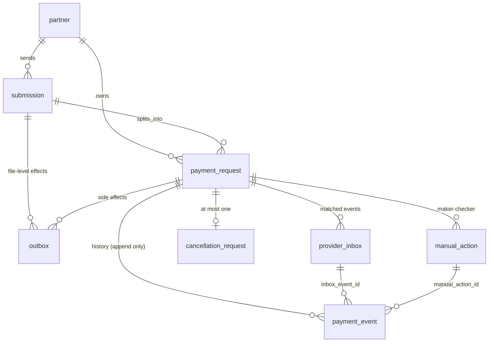

# Database

The recommended data model: PostgreSQL, single primary with a synchronous standby. It is two Flyway migrations: [V1__initial_schema.sql](../src/main/resources/db/migration/V1__initial_schema.sql) (the tables) and [V2__downstream_position_and_cancellation.sql](../src/main/resources/db/migration/V2__downstream_position_and_cancellation.sql) (two columns the state machine needs). The migrations are the source of truth for the structure; this page explains it and the rules it enforces. Change the schema through new migrations only. The design behind it is in [architecture.md](architecture.md).

## Structure at a glance



Every state change touches several tables in one transaction (see [Transactions](#transactions)):

```
input table ──► worker (lease) ──► payment_request  (state, due time, lease, event_seq)
provider_inbox                  ├─► payment_event    (one row per step)
cancellation_request            ├─► outbox           (one row per effect)
manual_action                   └─► input marked applied
```

## Tables

| Table | Purpose | Mutable? |
|---|---|---|
| `partner` | Partner configuration: acceptance mode, in-flight limit, runtime pause | Yes |
| `submission` | One row per file or API call, as received | Status only |
| `payment_request` | Current state of each instruction, its due time and lease | Yes |
| `payment_event` | Lifecycle history and business audit trail | Insert only |
| `provider_inbox` | Raw downstream events as received | Status and payment link only |
| `outbox` | Every side effect of a state change: partner deliveries and internal effects | Delivery fields only |
| `manual_action` | Maker-checker requests for state-changing manual actions | Status, decision and applied fields only |
| `cancellation_request` | Partner cancellation requests, applied by the worker | Applied field only |

"Mutable?" is enforced by grants to the application role, which are set per environment and are not in the migration. Retention and erasure (below) run under a separate maintenance role.

## Columns

`pk` primary key, `fk` foreign key, `uq` part of a unique constraint. Types are the Postgres types in the migration.

### partner

| Column | Type | Notes |
|---|---|---|
| `id` | uuid | pk |
| `external_ref` | text | uq. The partner's reference, used by the front doors |
| `name` | text | |
| `acceptance_mode` | text | `PARTIAL` (default) or `ALL_OR_NOTHING` |
| `max_in_flight` | integer | > 0, default 100 |
| `paused` | boolean | Runtime pause, default false |
| `created_at` | timestamptz | |

The proof of concept stores these but its core loop does not read `acceptance_mode`, `max_in_flight` or `paused`.

### submission

| Column | Type | Notes |
|---|---|---|
| `id` | uuid | pk |
| `partner_id` | uuid | fk `partner`; uq with `message_id` |
| `channel` | text | `API` or `FILE` |
| `message_id` | text | The partner's message id. A resend of the same message is a no-op |
| `received_at` | timestamptz | |
| `file_object_key` | text | Object storage key of the received file (personal data, see below) |
| `declared_count`, `declared_sum_minor` | integer, bigint | Control totals declared by a file |
| `status` | text | `RECEIVED`, `SPLIT` or `REJECTED` |

### payment_request

| Column | Type | Notes |
|---|---|---|
| `id` | uuid | pk |
| `partner_id` | uuid | fk; uq with `end_to_end_id` |
| `submission_id` | uuid | fk `submission`, indexed |
| `end_to_end_id` | text | The partner's id for the instruction |
| `content_hash` | text | Hash of the parsed content, to tell a resend from a conflict |
| `parent_ref` | text | Optional payment-plan reference, not interpreted |
| `state` | text | Not constrained in the schema (see [State values](#state-values)) |
| `amount_minor` | bigint | > 0, minor units |
| `currency` | char(3) | `[A-Z]{3}` |
| `amount_modification_allowed` | boolean | default false |
| `expires_at` | timestamptz | Internal expiry; not exercised by the proof of concept |
| `debtor_identification`, `creditor_identification`, `remittance_reference` | text | Personal data |
| `downstream` | text | Which downstream the payment was sent to |
| `downstream_ref` | text | The downstream's reference for it; unique per `downstream` |
| `send_attempt` | integer | default 0; with the id it forms the idempotency key |
| `next_action_at` | timestamptz | Due time; null = no automatic work |
| `lease_owner`, `lease_until` | text, timestamptz | The current claim |
| `lease_token` | bigint | Incremented on every claim; the fence |
| `event_seq` | integer | Last `payment_event.seq` written; the second half of the fence |
| `downstream_position` | text | V2. `SENDING`, `PRESENTED` or `ACCEPTED`; null until `SENDING` was recorded |
| `cancel_requested` | boolean | V2. A partner cancellation was applied. Default false |
| `created_at`, `updated_at` | timestamptz | |

### payment_event (partitioned by `recorded_at`)

| Column | Type | Notes |
|---|---|---|
| `payment_id`, `seq`, `recorded_at` | uuid, integer, timestamptz | pk; `payment_id` is a fk |
| `type` | text | What happened; see [event types](#event-types-the-poc-writes) |
| `from_state`, `to_state` | text | Equal for steps that do not change state |
| `outcome` | text | `APPLIED`, `INFERRED`, `STALE`, `NO_PATH` |
| `category` | text | `BUSINESS` or `TECHNICAL` |
| `actor_type`, `actor_id` | text | `PARTNER`, `SERVICE`, `DOWNSTREAM` or `ADMIN` |
| `reason`, `manual_action_id` | text, uuid | Both required for `ADMIN`; `manual_action_id` is a fk |
| `correlation_id` | text | One file or API call across its payments |
| `inbox_event_id` | bigint | fk `provider_inbox` |
| `payload` | jsonb | Mapped reason codes, downstream references; never personal data |
| `occurred_at`, `recorded_at` | timestamptz | |

### provider_inbox

| Column | Type | Notes |
|---|---|---|
| `id` | bigserial | pk |
| `provider`, `provider_event_id` | text | uq. `provider` uses the same values as `payment_request.downstream` |
| `provider_timestamp` | timestamptz | A hint, never the deciding vote |
| `received_at` | timestamptz | |
| `downstream_ref` | text | Extracted on arrival, used for matching |
| `payment_id` | uuid | fk; null while parked |
| `status` | text | `NEW`, `APPLIED`, `PARKED` |
| `payload` | jsonb | The event |

### outbox

| Column | Type | Notes |
|---|---|---|
| `id` | bigserial | pk |
| `payment_id`, `event_seq` | uuid, integer | A payment effect, keyed on the event that caused it |
| `submission_id` | uuid | fk; a file-level effect. Exactly one of `payment_id` and `submission_id` is set |
| `kind` | text | See [outbox](#outbox-1) |
| `payload` | jsonb | |
| `next_attempt_at`, `attempts`, `delivered_at` | timestamptz, integer, timestamptz | Delivery bookkeeping |

### manual_action

| Column | Type | Notes |
|---|---|---|
| `id` | uuid | pk |
| `payment_id` | uuid | fk, indexed |
| `action`, `reason` | text | |
| `requested_by`, `requested_at` | text, timestamptz | |
| `approved_by`, `approved_at` | text, timestamptz | Null while `PENDING` |
| `status` | text | `PENDING`, `APPROVED`, `REJECTED` |
| `applied_at` | timestamptz | Only for an approved action |

### cancellation_request

| Column | Type | Notes |
|---|---|---|
| `id` | uuid | pk |
| `payment_id` | uuid | fk; unique, so one request per payment |
| `requested_by`, `requested_at` | text, timestamptz | |
| `applied_at` | timestamptz | Set by the worker in the transaction that applies it |

## Indexes

| Index | On | Serves |
|---|---|---|
| `payment_request_due_idx` | `next_action_at` where not null | The timer path of the claim query |
| `payment_request_downstream_ref_idx` | unique `(downstream, downstream_ref)` where `downstream_ref` is not null | One payment per downstream reference; matching events |
| `payment_request_submission_idx` | `submission_id` | Payments of a submission |
| `provider_inbox_payment_idx` | `payment_id` where `status = 'NEW'` | Unapplied events of a payment |
| `provider_inbox_parked_idx` | `(provider, downstream_ref)` where `status = 'PARKED'` | Relinking parked events |
| `cancellation_request_unapplied_idx` | `payment_id` where `applied_at` is null | Unapplied cancellations |
| `manual_action_payment_idx`, `manual_action_unapplied_idx` | `payment_id` (the second where approved and not applied) | Actions of a payment |
| `outbox_due_idx` | `next_attempt_at` where `delivered_at` is null | Delivery |

## payment_request

The unit of processing. One row per instruction.

- **Identity.** `unique (partner_id, end_to_end_id)` is the idempotency key across channels and resends. `content_hash` detects a resend that reuses the id with different content: that is a conflict, never an update. It is computed over the parsed amount (so `12.5` and `12.50` are the same), with length-prefixed fields so no two different instructions can collide.
- **Money.** `amount_minor` is an integer in the currency's minor units; `currency` is the ISO 4217 code. No floats anywhere.
- **Work scheduling.** `next_action_at` is the due time. Null means no automatic work is due: either terminal (`PAID`, `REJECTED`, `REFUSED`, `EXPIRED`, `CANCELLED`) or waiting on a person (`UNKNOWN`, `MISMATCH`). Alerts on waiting states key on `state`, not on the due time. States that wait on the downstream (`SENDING`, `PRESENTED`, `ACCEPTED`, `CANCELLATION_REQUESTED`) are due after a response window, when the worker asks the downstream.
- **Only the lease holder writes state.** External inputs never update this table directly: provider events go to `provider_inbox`, cancellations to `cancellation_request`, approved manual actions stay in `manual_action`. The worker picks them up under a lease (the claim query includes payments with unapplied inputs) and applies them through the state machine. This is what makes the fence complete.
- **Lease and fencing.** `lease_owner` and `lease_until` record the current claim. `lease_token` increments on every claim. The result is a compare-and-set: `WHERE id = ? AND lease_token = ? AND event_seq = ?`. A slow worker cannot overwrite a takeover, and nothing else can have written in between. Every successful write renews the lease. Releasing it (null owner and expiry) is fenced on the token alone.
- **Event sequence.** `event_seq` is the last sequence number written to `payment_event` for this payment. The fenced update increments it by the number of events being written (more than one when a transition records inferred states) and returns the new value; every `payment_event` insert takes its `seq` from that value in the same transaction. That keeps the sequence gap-free and ordered, which the partitioned event table cannot enforce on its own.
- **Downstream.** `downstream` and `send_attempt` are stored in the transaction that records `SENDING`, before the downstream call, so a takeover mid-send knows which attempt was in flight. `downstream_ref` is stored only once the downstream has answered (the send response or a status query), so it can be null for a payment that was sent; events for such a payment stay parked until the reference is learned. The downstream idempotency key is derived from payment id and attempt, never from the worker. A reference that is not usable (empty, too long, control characters, or already held by another payment) is never stored: the payment goes to `UNKNOWN`.
- **Downstream position and cancellation** (V2). `downstream_position` is the last known downstream state (`SENDING`, `PRESENTED` or `ACCEPTED`), null until `SENDING` was recorded, which happens before the downstream call. It survives `UNKNOWN` and `CANCELLATION_REQUESTED`, which would otherwise forget how far the payment got: a late event is stale or applied relative to it, never relative to a guess. `cancel_requested` is set when a partner cancellation was applied; only then can a downstream cancellation confirmation be accepted, and not once the position is `ACCEPTED`. The state machine reads and returns both with the state. The `CHECK` on `downstream_position` is the one place the schema constrains state names; renaming an in-flight state needs a migration.
- **Plans.** `parent_ref` is an optional reference for whoever owns a payment plan. The engine does not interpret it.

### State values

The `state` column is not constrained in the schema while the state list is a draft. The recommended values are:

| Group | States |
|---|---|
| Worker steps | `RECEIVED`, `VALIDATED`, `PENDING_SCREENING`, `READY_TO_SEND` |
| Waiting on the downstream | `SENDING`, `PRESENTED`, `ACCEPTED`, `CANCELLATION_REQUESTED` |
| Waiting on a person | `UNKNOWN`, `MISMATCH` |
| Terminal | `PAID`, `REJECTED`, `REFUSED`, `EXPIRED`, `CANCELLED` |

## payment_event

Append-only. The application role has `INSERT` and `SELECT` only; no `UPDATE` or `DELETE` (granted outside the migration, per environment).

- One row per lifecycle event: `type`, `from_state`, `to_state`. A transition that infers skipped states writes one row per step.
- `outcome`: `APPLIED`, `INFERRED` (a skipped state on a valid path), `STALE` (recorded, not applied) or `NO_PATH` (contradicts the current state; the payment moves to `MISMATCH`).
- `category`: `BUSINESS` or `TECHNICAL`, so retries do not bury the events an auditor needs. `STALE` steps and bookkeeping that changes no state (storing a reference, an unavailable status answer) are `TECHNICAL`.
- `actor_type` and `actor_id`: partner, internal service, downstream, or admin user.
- `reason` and `manual_action_id` are required for `ADMIN` events (check constraint). That the linked action is approved is enforced by the application, not the schema.
- `occurred_at` (when it happened, per the source) and `recorded_at` (when we wrote it) are meant to differ for late downstream events. The proof of concept sets both to the time the worker applied the step; keep the source time from day one.
- `correlation_id` traces one file or API call across all its payments. `inbox_event_id` links to the raw provider event.
- `payload` holds mapped reason codes and downstream references, never personal data. The raw provider message stays in `provider_inbox`, linked by `inbox_event_id`.
- Partitioned by `recorded_at`, monthly. The migration creates 2026-11 to 2027-01; a scheduled job creates partitions ahead of time. The default partition is a safety net that should stay empty: a row there is an alert, because it blocks creating the partition for that range. Old partitions are detached and archived, subject to the retention policy.

### Event types

| Type | When |
|---|---|
| `RECEIVED` | Ingestion, sequence 1 |
| `VALIDATED`, `SCREENING_STARTED`, `SCREENING_PASSED` | The worker's pass-through steps |
| `SENDING` | Before the downstream call, with the attempt number |
| `SEND_RESPONSE`, `SEND_REJECTED` | The downstream answered the send |
| `SEND_TIMEOUT`, `SEND_TIMEOUT_RECOVERED` | The send raised an error; the status query found nothing, or found the payment |
| `STATUS_QUERY` | A status query changed something: stored the reference, or reported a state |
| `STATUS_UNAVAILABLE` | A status query went unanswered; it is retried a few times |
| `RESPONSE_TIMEOUT` | The response window passed in silence |
| `UNUSABLE_REFERENCE` | The downstream's reference could not be stored |
| `PROVIDER_EVENT` | A downstream event from the inbox was applied |
| `CANCEL_REQUESTED` | A partner cancellation was applied |

## provider_inbox

Downstream events, stored and acknowledged before any processing. The raw message belongs in `payload`; the proof of concept stores only the status (`{"status": ...}`).

- `unique (provider, provider_event_id)` drops duplicate deliveries before they reach the state machine.
- `provider_timestamp` is a hint, never the deciding vote; the state graph decides. The proof of concept sets it to the receive time.
- `status`: `NEW`, `APPLIED`, `PARKED` (no matching payment yet). Parked events are never acknowledged-and-dropped.
- Matching: on arrival the writer extracts `downstream_ref` and resolves `payment_id` by `(downstream, downstream_ref)`, where `provider` uses the same values as `payment_request.downstream`. Matched rows are inserted `NEW`, unmatched rows `PARKED` (check constraint: parked if and only if unlinked). The transaction that records a payment's `downstream_ref` re-links any parked rows for it and sets them `NEW`.
- A per-reference Postgres advisory lock (`pg_advisory_xact_lock` on provider and reference), held until commit, serialises receiving an event with storing the reference. Without it an event can be inserted `PARKED` at the moment the reference commits, and nobody links the two.

## outbox

Every side effect of a state change is written here in the same transaction as the state and event.

- A row belongs either to one payment or to a whole submission (a file-level status report, an all-or-nothing rejection), never both.
- Payment rows: `unique (payment_id, event_seq, kind)`, keyed on the event sequence, never on state, so a legitimate repeat of a state is not suppressed.
- `kind` is the effect type the state machine returned: `PARTNER_STATUS` (the only delivery to a partner, and only for partner-visible states), plus the internal `FORWARD_CANCELLATION`, `RECONCILIATION` and `ALERT`. Writing the internal ones here keeps them atomic with the state change: a worker that dies after committing cannot lose them. A dispatcher must deliver only `PARTNER_STATUS` to partners. The proof of concept writes all kinds but dispatches none.
- Delivery uses its own due time (`next_attempt_at`) and attempt count, and is re-drivable from this table alone.

## manual_action

Maker-checker. `requested_by` and `approved_by` must differ, a decided action always records who decided and when, and only an approved action can be marked applied (check constraints). The worker applies it under a lease, through the state machine like any other input, and sets `applied_at` in the same transaction. Not exercised by the proof of concept.

## cancellation_request

One per payment (unique on `payment_id`). The worker applies it under a lease and sets `applied_at`. The outcome (cancelled, forwarded downstream, or too late because the debtor already accepted) is a `payment_event`, not a field here.

## Personal data

Debtor and creditor identification lives in `payment_request`, not in `payment_event`. It also reaches other places, each needing its own retention and erasure rule:

- `provider_inbox.payload`: raw downstream events as received.
- `outbox.payload`: messages sent to partners.
- Received files in object storage (`submission.file_object_key`).
- Free-text `reason` fields: guidance for operators is to use references, not personal details.

Downstream calls are made by the worker directly, under its lease, not through the outbox; request bodies are not stored.

Erasure runs under the maintenance role: identification columns on `payment_request` are nulled, payloads are redacted in place (`'{}'`) once delivered, and received files are deleted. It never deletes rows that `payment_event` links to.

## Transactions

A state change is one transaction: fenced compare-and-set on `payment_request` (state, position, due time, `event_seq`), insert into `payment_event` with the returned sequence numbers, insert into `outbox`, and mark the consumed input (inbox event, manual action, cancellation) as applied. If the fencing check fails, nothing is written.

Claiming is its own short transaction: one `UPDATE ... WHERE id = (SELECT ... FOR UPDATE SKIP LOCKED LIMIT 1)` that sets the lease and increments `lease_token`. No row lock is held across a downstream call.

## Not in the schema yet

- Partner credentials and keys (KMS/HSM, not this database).
- Partner usage profiles and rule configuration.
- Reconciliation and statement matching tables.
- Per-downstream in-flight limits and the capability matrix.
- Monthly partition management (scheduled job).
- Grants enforcing the append-only and status-only rules.
- A raw-message column on `provider_inbox`, and a source timestamp on events.
