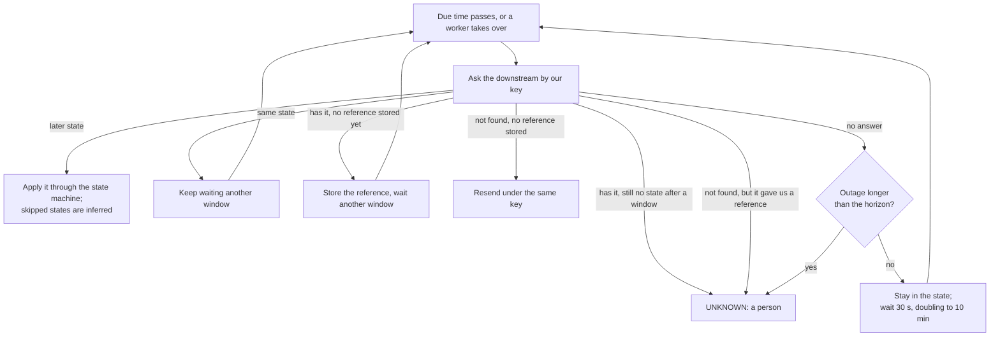

# Recovery and manual work

How the engine recovers from failures on its own, and which problems still need a person. The engine asks the downstream before it ever gives up on a payment, so the downstream's status endpoint is the main recovery path. Some downstreams have no status endpoint, and any endpoint can be down, so every recovery step has a fallback that ends with a person.

**Built** means the proof of concept does it, with a test; **designed** means the recommendation includes it but it is not built. The design behind each step is in [architecture.md](architecture.md); the gaps are in [poc-limits.md](poc-limits.md).

## Rules

- **Unknown is never failed.** A timeout, an exception or a lost response means the outcome is unknown. The engine asks before acting, and a payment it cannot place goes to `UNKNOWN`, never to a failure state.
- **Never resend blindly.** A resend uses the same idempotency key, and only after the downstream said it does not have the payment and we hold no reference from it.
- **An outage is not an unknown outcome.** While the downstream cannot answer, payments back off and wait. Only an outage longer than the horizon goes to a person.
- **A person decides only what the facts cannot.** That is a conflict between two sources, or a downstream that cannot tell us. Every manual action goes through the state machine like any other input, with maker-checker (designed).

## Sources of truth, fastest first

| Source | What it answers | When it is missing |
|---|---|---|
| Downstream event (webhook, reply, return file line) | A state change, pushed | Lost or late: the response window catches it |
| Status query by our key | The downstream's current view of one payment, on demand | No endpoint, or the downstream is down |
| Resend under the same key | Whether the downstream has the payment: a downstream that keeps keys answers a repeated key with the original result | Keys expire, or a repeated key gets a reject, so resending is unsafe |
| Downstream report (settlement or transaction report, status file) | Every payment's outcome for a period | Arrives hours or a day later |
| Bank statement (camt.053/054) | Whether money actually moved, and how much | The final word on money, but only on money |
| The downstream's operations team | Anything, through a person | Slow; needs a case |

Each downstream adapter declares which of these it has, how long keys are kept, what a repeated key returns, and how often reports arrive (the capability matrix in [architecture.md](architecture.md#downstream-systems)). The engine would set the outage horizon, response windows and the deadline for silence from that declaration (designed; the PoC has one setting for all).

## With a status endpoint (built)

Every waiting payment has a due time. When it passes, or when a worker takes over a payment from one that stopped, the worker asks the downstream by our idempotency key before doing anything else.

How each failure resolves:

| Failure | How it shows | Recovery | Status |
|---|---|---|---|
| Worker stops before the send | Lease expires; payment still `READY_TO_SEND` | Another worker takes over and sends | Built by lease expiry; no test of its own |
| Worker stops during the send | Lease expires; payment in `SENDING` | Ask the downstream: store its reference, or resend under the same key if it never arrived | Built |
| Send response lost (timeout after the downstream processed it) | Exception from the send | Ask at once; the downstream has it, so store the reference and wait | Built |
| Send never arrived | Exception; the downstream answers "not found" | Back off, resend under the same key | Built |
| Webhook lost | Response window passes with no event | Ask; apply the reported state | Built |
| Webhooks repeated or out of order | Event for a state already passed | Recorded as stale; the graph, not the clock, decides | Built |
| Webhook before the reference is known | Event matches no payment | Parked, linked when the reference is stored | Built |
| Downstream down | Status query fails or throws | Backoff up to the horizon (2 h by default); a status answer that finds the payment ends the outage | Built |
| Database failover | Connections drop | Work is idempotent per transaction; leases expire and workers reclaim; nothing is acknowledged before it is on the synchronous standby | Designed |
| Worker wake-up lost (`NOTIFY`) | Nothing visible | Workers poll; `NOTIFY` only wakes them sooner | Designed (the PoC polls) |
| Effect not delivered (partner status, cancellation forward, alert) | `outbox` row with no `delivered_at` | Written in the state change's transaction; a dispatcher retries until it is delivered | Outbox built, dispatcher designed |
| Partner's webhook endpoint down | Delivery fails | Retry with backoff; the partner can poll the status API meanwhile | Designed |

## Without a status endpoint (designed)

A downstream may offer no status query at all, or only by its own reference, which we do not have after a lost response. Recovery then moves down the table of sources: slower, and more of it ends with a person. The adapter declares the gap, and the engine changes three things for that downstream.

**1. A lost send response.** We cannot ask whether it arrived.

- Where the downstream keeps keys and answers a repeated key with the original result, resending under the same key is the status query: the answer is either the original result or a new acceptance of a payment it never had. The adapter does this within the key retention period only.
- Where keys expire, or a repeated key is rejected, a resend could pay twice or report a false reject. The payment waits for an event or the next report. If nothing mentions it by the report deadline, it goes to `UNKNOWN`.
- A failure before the request left us (connection refused, DNS failure) is safe to retry: the downstream never saw it. Only a failure after the request was sent is unknown.

**2. A lost webhook.** We cannot ask what happened.

- Most downstreams that push events redeliver them for a while, and some offer a replay of events since a given time. The adapter uses replay after any outage or restart.
- The response window for that downstream becomes "until the next report, plus a margin". Silence before the report is expected, not a reason for `UNKNOWN`.

**3. Silence is resolved by reports.** Each report or status file is read into the provider inbox, one event per line, and applied through the state machine like a webhook. Reports also resolve `UNKNOWN`: a payment that a report shows as paid or rejected leaves `UNKNOWN` automatically, so a person looks only at payments no report mentions by its deadline. Statement reconciliation confirms `SETTLED` for every downstream, with or without a status endpoint.

In code this is one more answer from the adapter (status not supported), a per-downstream deadline for silence instead of the response window, and report ingestion into the provider inbox. None of it is built.

## What needs a person

Each item lands in a queue with an owner and an alert. The person checks with the downstream or the statements, then records a manual action, which a second person approves and the worker applies through the state machine. Manual actions are designed, not built.

### `UNKNOWN`: we cannot tell what happened

| Cause | Why the engine cannot decide | Status |
|---|---|---|
| An outage longer than the horizon, including a send endpoint that stays down while status queries answer "not found" | The downstream has been unreachable, or unable to take the payment, for 2 hours; a resend after its key retention could pay twice | Built |
| The downstream cannot find a payment it gave us a reference for | It accepted the payment once; resending would create a second one | Built |
| The downstream has the payment but reports no state after a window | It neither progressed nor failed, and asking again repeats the same answer | Built |
| The downstream gives a reference we cannot store, or one another payment already holds | Retrying repeats the same answer | Built |
| A cancelled payment the downstream never received | A failed send leaves the payment in `SENDING`; the cancellation then finds nothing downstream. It could be cancelled outright once nothing can still be in flight; left as a known gap ([poc-limits.md](poc-limits.md)) | Built, no test of its own (gap) |
| No status endpoint: a lost response where a resend is unsafe and no report mentions the payment by its deadline | No source can place it | Designed |

`UNKNOWN` is internal: the partner keeps seeing the last status. A late event from the downstream still resolves it (built). Re-checking `UNKNOWN` on a long backoff before a person looks is the next safety net ([architecture.md](architecture.md#downstream-outages)).

### `MISMATCH`: two sources disagree

| Cause | Why | Status |
|---|---|---|
| An event with no path from the current state, such as a cancellation we never asked for, or one confirmed after the debtor accepted | The downstream says something our record says cannot happen | Built |
| A reject, refusal, expiry or cancellation after `PAID` | Money came back, or should never have moved; partners are not told until a person decides | Built |
| A settlement amount that differs from the request, or several credits for one request | Money moved, but not as asked | Designed |

`MISMATCH` never changes on its own and ignores later events.

### Alerts with no state change

| Alert | Status |
|---|---|
| A different outcome after a final state, such as `PAID` after `CANCELLED`, or a reject after `SETTLED`: recorded as stale, money may have moved | Built |
| A payment `PAID` but not `SETTLED` by its deadline | Designed |
| Provider events parked with no matching payment past a deadline | Designed |
| Effects or partner deliveries failing past a limit | Designed |
| A downstream file rejected whole, or a report not arriving | Designed |

### Not a person, but a known gap

- A cancellation that arrives too late is recorded and ignored; the partner is not told. Telling them needs a new partner status.
- A downstream that keeps reporting the same status keeps a payment waiting indefinitely: internal request expiry is not built.

## Next steps to shrink the manual queue

1. **Circuit breaker per downstream.** During an outage, new sends wait instead of each failing once. After it, a warm-up ramps the rate up so the recovering downstream is not flooded, oldest waiting payments first.
2. **`UNKNOWN` re-checks itself** on a long backoff before a person looks.
3. **Reports and statements resolve `UNKNOWN` automatically,** for every downstream, not only those without a status endpoint.
4. **Bulk manual actions** after an incident, so one approved decision can resolve many payments with the same cause.
