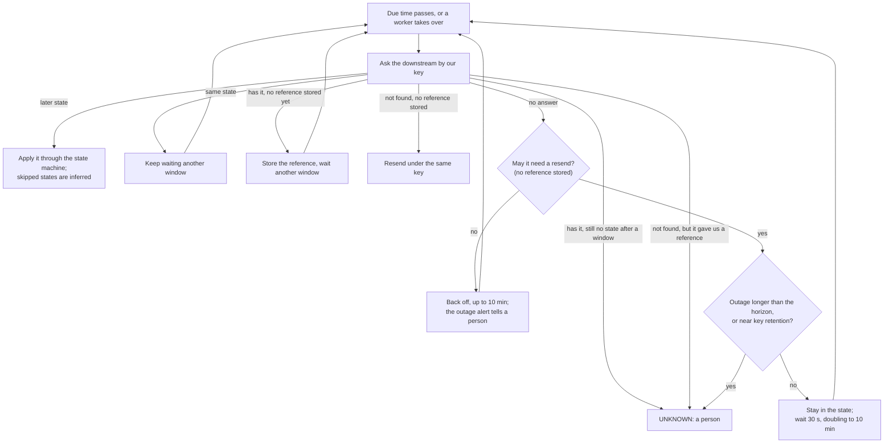

# Recovery and manual work

How the engine recovers from failures on its own, and which problems still need a person. The engine asks the downstream before it ever gives up on a payment, so the downstream's status endpoint is the main recovery path. Some downstreams have no status endpoint, and any endpoint can be down, so every recovery step has a fallback that ends with a person.

**Built** means the proof of concept does it, with a test; **built, untested** means the code does it but no test of its own covers it; **designed** means the recommendation includes it but it is not built. Designed rows say **R1** (the first release) or **later** (when its trigger arrives, see [architecture.md](architecture.md#delivery-and-the-first-release)). The states named here are defined in the [states table](architecture.md#states-and-partner-statuses); the gaps in the proof of concept are in [poc-limits.md](poc-limits.md).

## Rules

- **Unknown is never failed.** A timeout, an exception or a lost response means the outcome is unknown. The engine asks before acting, and a payment it cannot place goes to `UNKNOWN`, never to a failure state.
- **Never resend blindly.** A resend uses the same idempotency key, and only after the downstream said it does not have the payment and we hold no reference from it.
- **An outage is not an unknown outcome.** While the downstream cannot answer, payments back off and wait. Only a payment that may need a resend, caught in an outage longer than the horizon, goes to a person.
- **A person decides only what the facts cannot.** That is a conflict between two sources, or a downstream that cannot tell us. Every manual action goes through the state machine like any other input, with maker-checker ([operations.md](operations.md#manual-actions)).

## Sources of truth, fastest first

| Source | What it answers | When it is missing |
|---|---|---|
| Downstream event (webhook, reply, return file line) | A state change, pushed | Lost or late: the response window catches it |
| Status query by our key | The downstream's current view of one payment, on demand | No endpoint, or the downstream is down |
| Resend under the same key | Whether the downstream has the payment: a downstream that keeps keys answers a repeated key with the original result | Keys expire, or a repeated key gets a reject, so resending is unsafe |
| Downstream report (settlement or transaction report, status file) | Every payment's outcome for a period | Arrives hours or a day later |
| Bank statement (camt.053/054) | Whether money actually moved, and how much | The final word on money, but only on money |
| The downstream's operations team | Anything, through a person | Slow; needs a case |

Each downstream adapter declares which of these it has, how long keys are kept, what a repeated key returns, and how often reports arrive (the capability matrix in [architecture.md](architecture.md#downstream-systems)). The engine sets the outage horizon, response windows and the deadline for silence from that declaration (designed, R1; the proof of concept has one setting for all).

## With a status endpoint

Every waiting payment has a due time. When it passes, or when a worker takes over a payment from one that stopped, the worker asks the downstream by our idempotency key before doing anything else.

How each failure resolves:

| Failure | How it shows | Recovery | Status |
|---|---|---|---|
| Worker stops before the send | Lease expires; payment still `READY_TO_SEND` | Another worker takes over and sends | Built, untested |
| Worker stops during the send | Lease expires; payment in `SENDING` | Ask the downstream: store its reference, or resend under the same key if it never arrived | Built |
| Send response lost (timeout after the downstream processed it) | Exception from the send | Ask at once; the downstream has it, so store the reference and wait | Built |
| Send never arrived | Exception; the downstream answers "not found" | Back off, resend under the same key | Built |
| Webhook lost | Response window passes with no event | Ask; apply the reported state | Built |
| Webhooks repeated or out of order | Event for a state already passed | Recorded as stale; the graph, not the clock, decides | Built |
| Webhook before the reference is known | Event matches no payment | Parked, linked when the reference is stored | Built |
| Downstream down | Status query or send fails or throws | [Downstream outages](#downstream-outages) | Built for every payment; limited to payments that may need a resend: designed, R1 |
| Database failover | Connections drop | Work is idempotent per transaction; leases expire and workers reclaim; only a synchronous standby is promoted ([database.md](database.md#availability)) | Designed, R1 |
| A standby is lost | Nothing visible to partners | Quorum commit keeps writes going; a commit that times out waiting is "outcome unknown", never success | Designed, R1 |
| Database restored to an earlier point | Payments after the restore point are gone, but the downstream may have them | [Restore runbook](#restore-to-an-earlier-point) | Designed, R1 |
| A payment fails every time it is claimed (poison) | Its failure count rises | Backoff, then `QUARANTINED` with an alert ([database.md](database.md#claiming)) | Designed, R1 |
| A downstream's planned maintenance | Announced window | Its gate holds sends and freezes the horizon; status queries continue ([operations.md](operations.md#gates)) | Designed, later |
| Worker wake-up lost (`NOTIFY`) | Nothing visible | Workers poll; `NOTIFY` only wakes them sooner | Designed, R1 (the proof of concept polls) |
| Effect not delivered | `outbox` row with no `delivered_at` | Written in the state change's transaction. Partner statuses go through the dispatcher; cancellation forwards through the worker, which claims any payment with an undelivered forward; alerts and reconciliation rows through their own consumers ([database.md](database.md#outbox-1)) | Outbox built; delivery designed, R1 |
| Partner's webhook endpoint down | Delivery fails | Retry with backoff until a maximum delivery age, then point the partner at the status API and its "changes since" feed | Designed, later (a second partner) |

## Downstream outages

When a downstream is down, every payment that waits on it fails its next call. Treating each failure as an unknown outcome sent every payment in the outage to a person: in the proof of concept, all 11 payments caught in a 30-minute outage ended in `UNKNOWN`. Options considered:

| Option | What it does | Verdict |
|---|---|---|
| Back off per payment, with a horizon | Failed sends and unanswered status queries keep the payment in its state; the wait doubles from 30 seconds to a 10-minute cap, with jitter; a status answer that finds the payment, or any state change, ends an outage | Chosen. Built, except the jitter (designed, R1) and the narrower horizon below |
| Circuit breaker per downstream | Stops new sends while the downstream is known to be down; probes, then resumes with a warm-up | Designed, later: part of the downstream's [gate](operations.md#gates). Saves load and failed calls, but on its own resolves nothing |
| `UNKNOWN` re-checks itself | `UNKNOWN` asks the downstream again before a person looks | No longer needed as the outage safety net, because acknowledged payments no longer reach `UNKNOWN` through an outage. Kept, later, with a smaller job: once a downstream is back, ask once about the payments an outage sent to `UNKNOWN` |
| Bulk reconciliation after recovery | Matches a downstream report or statement against everything affected | Belongs to reconciliation; needed for downstreams that cannot answer status queries |

**The horizon applies only to payments that may need a resend:** those with no stored reference, or that the downstream says it does not have. A resend is safe only while the downstream still keeps the key, so such a payment goes to `UNKNOWN` once the outage outlasts the horizon (2 hours by default, set per downstream). A payment the downstream has acknowledged, with a reference stored, never needs a resend, so it keeps backing off at the cap while the downstream's outage alert tells a person; it never goes to `UNKNOWN` because of an outage alone. With backoff, the 30-minute outage in the proof of concept needed nobody, and each payment made at most 8 failed attempts. Designed, R1; the proof of concept applies the horizon to every payment.

**Freezes, never past key retention.** A pause, the kill switch or a declared maintenance window freezes the horizon of the payments it holds back, so a long pause does not send them all to a person. But the time since a payment's first possibly-delivered send must stay inside the downstream's key retention: a payment that would cross it goes to `UNKNOWN` even while frozen. So the horizon, plus any frozen time and the warm-up, must stay inside key retention. Designed: pauses and the kill switch R1, maintenance windows later.

**Warm-up after an outage.** Jitter spreads retries out, but once a downstream is back every waiting payment still arrives within one backoff window, on a service with cold caches and connection pools. The gate's circuit therefore resumes slowly: open (nothing sent), half-open (a few probes), then a send rate that starts low and climbs to normal, shared by retries and new sends. Waiting payments go first, oldest first, so those nearest the horizon are served before they reach a person. Designed, later.

A send that failed while the downstream answers status queries with "not found" is retried the same way: the downstream says it never arrived. A send endpoint that stays down while status queries answer "not found" is one outage, and reaches `UNKNOWN` at the horizon.

## Restore to an earlier point

Designed, R1. A restore rewinds payments, attempts and event sequences, while the downstream and partners keep what they saw. The runbook:

1. Stop the workers and the dispatcher. The kill switch alone is not enough, because a gate blocks only sends.
2. For every payment not final in the restored database, or that became final within the margin before the restore point, write one `RESTORED` event whose sequence jumps past the highest any partner may have received. That number comes from the delivery log the dispatcher keeps outside the database, because the outbox itself was rewound. Event ids are globally unique values, never derived from a sequence a restore could reuse.
3. Start the workers with the kill switch on. Ask the downstream about those payments under attempt 1, 2 and so on, until it does not know an attempt whose key is still inside its retention ([attempt rule](database.md#payment_request-1)). Apply what it reports.
4. Re-ingest the files received since the restore point from write-once object storage, and ask API partners to resend what was acknowledged in that window. Deduplication makes both safe, and because downstream keys come from the partner's own ids, a resend carries the same key.
5. Start the dispatcher, then turn off the kill switch.

## Without a status endpoint

Designed, later (a non-synchronous downstream). A downstream may offer no status query at all, or only by its own reference, which we do not have after a lost response. Recovery then moves down the table of sources: slower, and more of it ends with a person. The adapter declares the gap, and the engine changes three things for that downstream.

**1. A lost send response.** We cannot ask whether it arrived.

- Where the downstream keeps keys and answers a repeated key with the original result, resending under the same key is the status query: the answer is either the original result or a new acceptance of a payment it never had. The adapter does this within the key retention period only.
- Where keys expire, or a repeated key is rejected, a resend could pay twice or report a false reject. The payment waits for an event or the next report. If nothing mentions it by the report deadline, it goes to `UNKNOWN`.
- A failure before the request left us (connection refused, DNS failure) is safe to retry: the downstream never saw it. Only a failure after the request was sent is unknown.

**2. A lost webhook.** We cannot ask what happened.

- Most downstreams that push events redeliver them for a while, and some offer a replay of events since a given time. The adapter uses replay after any outage or restart.
- The response window for that downstream becomes "until the next report, plus a margin". Silence before the report is expected, not a reason for `UNKNOWN`.

**3. Silence is resolved by reports.** Each report or status file is read into the provider inbox, one event per line, and applied through the state machine like a webhook. Reports also resolve `UNKNOWN`: a payment that a report shows as paid or rejected leaves `UNKNOWN` automatically, so a person looks only at payments no report mentions by its deadline. Statement reconciliation confirms `SETTLED` for every downstream, with or without a status endpoint.

In code this is one more answer from the adapter (status not supported), a per-downstream deadline for silence instead of the response window, and report ingestion into the provider inbox. None of it is built.

## What needs a person

Each item lands in a queue with an owner ([operations.md](operations.md#queues-and-owners)). The person checks with the downstream or the statements, then records one of the defined [manual actions](operations.md#manual-actions) with its evidence, which a second person approves and the worker applies through the state machine. Manual actions are designed, R1.

### `UNKNOWN`: we cannot tell what happened

| Cause | Why the engine cannot decide | Status |
|---|---|---|
| A payment that may need a resend, caught in an outage longer than its downstream's horizon, including a send endpoint that stays down while status queries answer "not found" | A resend after the key retention could pay twice | Built (for every payment; narrowed to these: designed, R1) |
| A frozen payment that would outlast the downstream's key retention | The same: a resend could pay twice | Designed, R1 |
| The downstream cannot find a payment it gave us a reference for | It accepted the payment once; resending would create a second one | Built |
| The downstream has the payment but reports no state after a window | It neither progressed nor failed, and asking again repeats the same answer | Built |
| The downstream gives a reference we cannot store, or one another payment already holds | Retrying repeats the same answer | Built |
| A cancellation, partner's or expiry's, that the downstream never answers | Silence is never a final status | Built for partner cancellations; expiry designed, R1 |
| A cancelled payment the downstream never received | A failed send leaves the payment in `SENDING`; the cancellation then finds nothing downstream. An accepted gap, resolved by the manual action "cancel a payment the downstream never had" | Built, untested (gap) |
| No status endpoint: a lost response where a resend is unsafe and no report mentions the payment by its deadline | No source can place it | Designed, later |

A late event from the downstream still resolves `UNKNOWN` (built).

### `MISMATCH`: two sources disagree

| Cause | Why | Status |
|---|---|---|
| An event with no path from the current state, such as a cancellation we never asked for, or one confirmed after the debtor accepted | The downstream says something our record says cannot happen | Built |
| A reject, refusal, expiry or cancellation after `PAID` | Money came back, or should never have moved | Built |
| A partial credit at the not-paid deadline, or a total still short at the settlement deadline | Money moved, but not as asked, or the downstream says paid and the statement disagrees | Designed, R1 |
| A credit that takes the total over the amount rule before `SETTLED` | Money moved, but more than asked | Designed, R1 |

`MISMATCH` never changes on its own and ignores later events.

### Other queues

| Queue | Cause | Status |
|---|---|---|
| `SCREENING_REVIEW` | A potential sanctions or AML match; a two-person decision | Designed, R1 |
| `QUARANTINED` | A payment that failed on every claim | Designed, R1 |
| Held files | A file whose hash, or count plus control sum, matches a recent file from the same partner | Designed, R1 with files |
| Unmatched credits | A statement credit that matches no request, or several; matched by hand | Designed, R1 |
| Overpayment and return records | Money beyond the amount rule, or returned, after `SETTLED`; `SETTLED` does not change | Designed, R1 |
| Open payments near the end of the legal period | A payment still not final as its month nears the end of the period ([database.md](database.md#retention-and-erasure)) | Designed, later |

### Not a person: partner-visible outcomes

A request accepted but not paid by its deadline becomes `NOT_PAID` once the downstream has been asked. Money that arrives after a not-paid final state, as a `PAID` event or a matched credit, becomes `PAID_LATE`. Both go to the partner, not to a queue (designed, R1).

### Alerts with no state change

| Alert | Status |
|---|---|
| A different outcome after a final state, such as a reject after `SETTLED`: recorded as stale, money may have moved. The proof of concept also treats `PAID` after `CANCELLED` this way; the design moves it to `PAID_LATE` | Built |
| An acknowledged payment backing off at the cap in a long outage | Designed, R1 |
| Provider events parked with no matching payment past a deadline | Designed, R1 |
| Effects or partner deliveries failing past a limit | Designed, R1 |
| A scheduled job that missed its run, or too few future partitions | Designed, R1 |
| A downstream file rejected whole, or a report not arriving | Designed, later |

The full alert list, with owners, is in [operations.md](operations.md#alerts).

### Not a person, but a known gap

- A cancellation that arrives too late is recorded and ignored; the partner is not told. The design adds a refusal status in Step 0.
- A downstream that keeps reporting the same status keeps a payment waiting indefinitely: internal request expiry is not built.

## Later steps to shrink the manual queue

1. **Circuit breaker and warm-up per downstream** (later): during an outage, new sends wait instead of each failing once, and the recovering downstream is not flooded.
2. **Ask once more after an outage** (later): payments an outage sent to `UNKNOWN` are asked about once the downstream is back.
3. **Reports and statements resolve `UNKNOWN` automatically** (later), for every downstream, not only those without a status endpoint.
